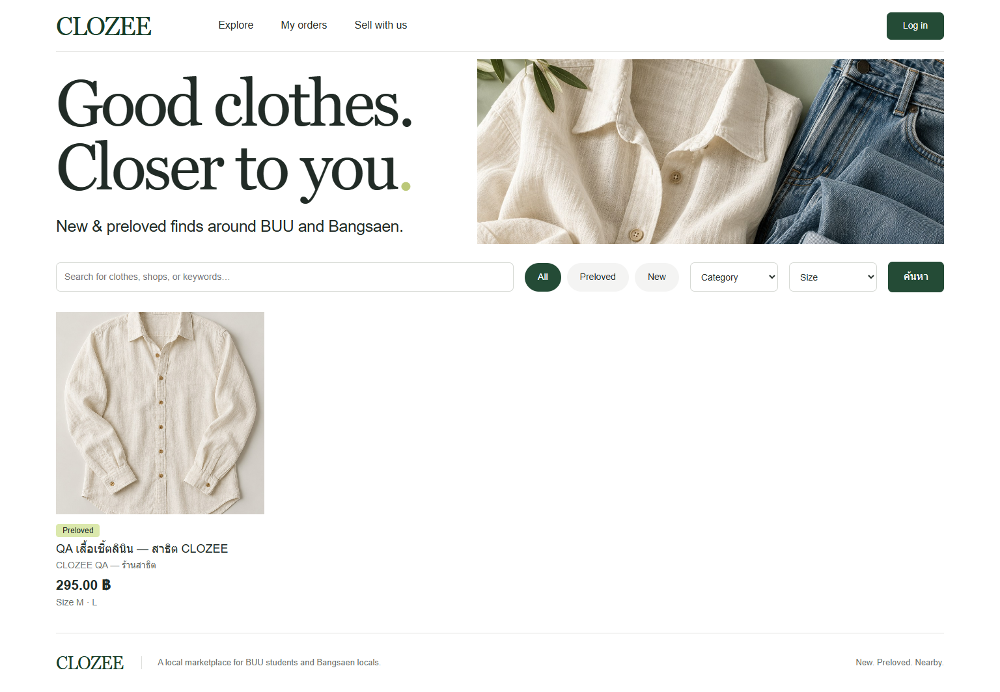

# CLOZEE

**แพลตฟอร์มซื้อขายและจัดส่งเสื้อผ้าในพื้นที่** — เว็บแอปสำหรับเสื้อผ้ามือหนึ่งและมือสอง โดยเน้นนิสิตมหาวิทยาลัยบูรพา (BUU) และผู้คนในบางแสน  
รายวิชา **89022167 Database Management** · กำหนดส่งงานรอบสุดท้าย **10 พฤศจิกายน 2569**

> **สถานะโครงการ:** เว็บไซต์บน Angsila ใช้งานได้และระบบหลักผ่านการทดสอบจริงแล้ว โดยเก็บงาน Lab เดิมไว้ครบ ยังต้องเติมชื่อผู้จัดทำ/สมาชิก/อาจารย์ในหน้าปกและยืนยันรายละเอียดการส่งก่อนส่งฉบับสมบูรณ์ ไม่ได้อ่านหรือใช้รหัสผ่านจาก Google Sheets และยังไม่ยืนยันการเข้าถึงนอก VPN

**เว็บไซต์:** [เปิด CLOZEE บน Angsila](https://angsila.informatics.buu.ac.th/~68160207/clozee/) — ทดสอบผ่าน VPN มหาวิทยาลัยแล้ว สมัครบัญชีใหม่เพื่อทดลองใช้งานได้ สินค้าและบัญชีที่มีชื่อ QA เป็นข้อมูลทดสอบสมมติ

ฐาน Angsila ใช้ `table_prefix = clozee_` แยกจากตาราง Lab เดิม ดู [ผลทดสอบฐานข้อมูลร่วม](docs/shared-database-tests.md) และ [ผลตรวจการติดตั้ง](docs/deployment-verification.md) Local ผ่าน 51 ข้อด้านระบบ/ฐานข้อมูลและ 24 ข้อผ่านเบราว์เซอร์ทั้งสอง namespace; Angsila ผ่าน 30 functional checkpoints และ 17 anonymous HTTP/security checks พร้อมภาพ desktop/mobile จากเบราว์เซอร์ใหม่ ขอบเขต local/CI/live แยกกันชัดเจนในรายงาน

**ลิงก์สำคัญ:** [ซอร์สโค้ด CLOZEE](https://github.com/Skyce38/CLOZEE) · [ผลทดสอบ MySQL บน GitHub Actions](https://github.com/Skyce38/CLOZEE/actions/runs/41109199837) · [ข้อกำหนดรายวิชา](docs/course-requirements.md) · [รายงานรอบ 2 (PDF)](docs/CLOZEE-Final-Report-Round2.pdf)



> **สาขา product photos:** เพิ่มรูปสินค้าสูงสุด 4 รูป พร้อมแบรนด์ รอบอก ความยาว และสภาพ/ตำหนิ ทดสอบในเครื่องแล้ว แต่ยังไม่ได้อัปเดต Angsila ต้องตรวจ Extension/สิทธิ์พื้นที่เก็บรูปและอนุมัติ migration ก่อน ดู [รายละเอียดและผลทดสอบ](docs/product-photos.md) รายงาน PDF และหลักฐาน Angsila ด้านบนยังอธิบายรุ่นที่ Deploy อยู่

ผลตรวจเซิร์ฟเวอร์ล่าสุด: Angsila ไม่มี GD และ PHP เขียน private storage ไม่ได้ จึงหยุดก่อนเปลี่ยนโค้ดหรือฐานข้อมูล ดู [ผล preflight และทางเลือก](docs/angsila-product-photos-preflight.md)

## ฟังก์ชันหลักของระบบ

- **สมัครสมาชิก / เข้าสู่ระบบ / ออกจากระบบ:** จัดเก็บรหัสผ่านแบบ Hash, จัดการ Session, ป้องกัน CSRF และจำกัดการแก้ไขข้อมูลตามสิทธิ์เจ้าของ
- **ร้านค้าและสินค้า:** หนึ่งบัญชีสร้างร้านได้หนึ่งร้าน พร้อมเพิ่ม แก้ไข และปิดใช้งานร้านหรือสินค้า (CRUD) รวมถึงจัดการไซซ์ ราคา สต็อก และป้องกันการแก้ไขทับข้อมูลเก่า
- **เลือกซื้อเสื้อผ้า:** ค้นหาและกรองสินค้ามือหนึ่ง/มือสอง หมวดหมู่ และไซซ์ ดูรายละเอียดสินค้าและร้านค้า พร้อมตะกร้าสินค้าจากร้านเดียวต่อคำสั่งซื้อ
- **สั่งซื้อและรับสินค้า:** Checkout ที่บันทึกข้อมูลแบบ Transaction, ป้องกันการส่งคำขอซ้ำ, ล็อกแถวสต็อก, เลือกนัดรับหรือจัดส่ง, คำนวณค่าจัดส่งฝั่งเซิร์ฟเวอร์ และเก็บข้อมูลสินค้า ณ เวลาสั่งซื้อ
- **จัดการคำสั่งซื้อ:** ผู้ขายเปลี่ยนสถานะได้เฉพาะลำดับที่อนุญาต คืนสต็อกเมื่อยกเลิกเพียงครั้งเดียว มีประวัติการเปลี่ยนสถานะ และผู้ซื้อดูคำสั่งซื้อของตนเองได้
- **แชทกับผู้ขาย:** สนทนาแบบข้อความระหว่างผู้ซื้อกับผู้ขาย โดยอนุญาตเฉพาะผู้เข้าร่วมสนทนาและใช้การรีเฟรชด้วยตนเอง
- **รองรับมือถือและคอมพิวเตอร์:** Responsive UI พร้อมภาพสินค้าตัวอย่างที่จัดเตรียมไว้ในโครงการ

**ขอบเขตที่ยังไม่รองรับ:** ระบบชำระเงินออนไลน์, ไรเดอร์/GPS, การเชื่อมต่อบริษัทขนส่งจริง, การคืนเงิน, BUU Single Sign-On (SSO) และระบบวิเคราะห์ยอดขาย ส่วนรูปสินค้าหลายรูปพร้อมอัปโหลดโดยผู้ขายพัฒนาในสาขานี้แล้ว ยังไม่ติดตั้งบน Angsila สินค้าที่มีประวัติคำสั่งซื้อจะถูกปิดใช้งานแทนการลบข้อมูลจริง ดูรายละเอียดที่ [บันทึกการตัดสินใจในการพัฒนา](docs/implementation-decisions.md)

## ความต้องการของระบบ

- **PHP 8.1 ขึ้นไป** พร้อม Extension `pdo_mysql`, `mbstring`, `session`, `fileinfo`, `gd` และ `exif`
- **MySQL 8.0.16 ขึ้นไป** หรือ **MariaDB 10.6 ขึ้นไป** โดยรองรับ InnoDB, utf8mb4 และการบังคับใช้ข้อกำหนด `CHECK`
- **Apache** ที่ตั้งค่า Document Root ไปยัง `public/` หรือใช้ PHP Development Server สำหรับทดสอบบน Local
- **Node.js 22 ขึ้นไป** ใช้เฉพาะการทดสอบผ่านเบราว์เซอร์และเครื่องมือสร้าง Diagram/PDF (ไม่ต้องใช้บน Production)
- **Python 3** ใช้เฉพาะสร้างเอกสารใหม่จาก Metadata

**เวอร์ชันที่ทดสอบแล้ว:** Local ใช้ PHP 8.5.12 / MariaDB 11.4.9 และ GitHub CI ใช้ PHP 8.3.36 / MySQL 8.4.13 Angsila ตรวจพบ MySQL 8.0.46 และ PHP 8.4.27 จาก phpMyAdmin แต่ต้องตรวจ GD/EXIF และข้อจำกัดอัปโหลดในบริบทเว็บ CLOZEE เพิ่มเติม

## วิธีติดตั้งและรันบนเครื่อง Local

### 1. ดาวน์โหลด Source Code

Clone Repository ไปยังโฟลเดอร์ที่ **ไม่อยู่ภายใน Public Web Root**

```sh
git clone https://github.com/Skyce38/CLOZEE.git
cd CLOZEE
```

### 2. สร้างฐานข้อมูลใหม่

สร้างฐานข้อมูล **ใหม่และว่างเปล่า** ด้วยบัญชี Local ที่มีสิทธิ์ถูกต้อง ห้ามใช้ฐานข้อมูลที่มีข้อมูลสำคัญ ตัวอย่าง SQL นี้ไม่มีรหัสผ่าน

```sql
CREATE DATABASE clozee CHARACTER SET utf8mb4 COLLATE utf8mb4_unicode_ci;
```

### 3. ตั้งค่าการเชื่อมต่อฐานข้อมูล

คัดลอก `app/config/example.php` ไปเป็น `app/config/local.php` แล้วกรอกค่าการเชื่อมต่อที่ใช้ในเครื่องของตนเอง ไฟล์ `local.php` ถูกตั้งค่าให้ Git ไม่ติดตาม และต้องอยู่ **นอกโฟลเดอร์ `public/`** เสมอ

- หากทดสอบผ่าน HTTP บน Local ให้กำหนด `secure_cookies` เป็น `false` ได้เฉพาะในเครื่องทดสอบ
- เมื่อ Deploy บน HTTPS ให้คงค่า `secure_cookies` เป็น `true`
- ตัวแปร Environment ที่รองรับ: `CLOZEE_DB_HOST`, `CLOZEE_DB_PORT`, `CLOZEE_DB_NAME`, `CLOZEE_DB_USER`, `CLOZEE_DB_PASS`, `CLOZEE_BASE_PATH`, `CLOZEE_DELIVERY_FEE`, `CLOZEE_SECURE_COOKIES` (ใช้ `1` หรือ `0` เฉพาะ Local)
- แอปไม่ได้โหลดไฟล์ `.env` โดยอัตโนมัติ
- `base_path` เป็นค่าว่างเมื่อรันที่ Root ของ Localhost หรือกำหนดเป็น Prefix ของโฟลเดอร์ที่ Deploy โดย **ไม่ต้องมี `/` ปิดท้าย**

### 4. สร้างตารางและเพิ่มข้อมูลตัวอย่าง

สามารถ Import Schema ด้วย phpMyAdmin ลงฐานข้อมูลว่าง หรือใช้คำสั่งต่อไปนี้

```sh
php scripts/migrate.php --empty-database
php scripts/seed.php --demo-only
php scripts/doctor.php
```

**ข้อควรระวัง:** `migrate.php` จะไม่ทำงานหากพบตารางเดิมในฐานข้อมูล และ `seed.php` จะปฏิเสธการเพิ่มข้อมูลเมื่อมีผู้ใช้อยู่แล้ว ทั้งสองคำสั่งไม่ใช่เครื่องมืออัปเกรดหรือล้างฐานข้อมูล และ Schema ไม่มีคำสั่ง CREATE/DROP DATABASE หาก Import เกิดข้อผิดพลาดให้ตรวจสอบก่อนรันซ้ำ เพราะคำสั่ง DDL บางชนิด Commit โดยอัตโนมัติ

ข้อมูลตัวอย่างประกอบด้วยบัญชีสมมติบนโดเมน `example.test`, ร้านค้า 3 ร้าน สินค้า 4 รายการ และตัวเลือกไซซ์/สต็อก 10 รายการ รหัสผ่านตัวอย่างจะถูกสร้างใหม่และบันทึกใน **`storage/demo-accounts.json`** ซึ่งอยู่ภายนอกโฟลเดอร์ Public และไม่ถูกติดตามโดย Git ให้เปิดอ่านเฉพาะในเครื่องเพื่อทดสอบเท่านั้น **ห้ามอัปโหลด แชร์ หรือ Commit ไฟล์นี้** และห้ามนำข้อมูลบัญชีจาก Google Sheets จริงมาใช้ สำหรับ Production ให้ข้ามขั้นตอนเพิ่ม Demo Seed

### 5. เปิดเว็บไซต์บน Local

```sh
php -S 127.0.0.1:8088 -t public
```

เปิด [CLOZEE บนเครื่อง Local](http://127.0.0.1:8088/) โดยต้องเปิด Terminal ที่รันเซิร์ฟเวอร์ค้างไว้

> PHP Development Server ใช้สำหรับพัฒนาและทดสอบบน Local เท่านั้น ไม่ใช่เว็บเซิร์ฟเวอร์สำหรับให้บริการสาธารณะ

## แนวทางสาธิตโปรเจกต์

สร้างบัญชีสมมติ 2 บัญชี ได้แก่ **ผู้ซื้อ** และ **ผู้ขาย** แล้วทดลองตามลำดับ:

1. ผู้ขายเข้าสู่ระบบ เลือกเมนูสำหรับเปิดร้าน สร้างร้านค้า แล้วลงขายเสื้อผ้าโดยกำหนดไซซ์ ราคา และสต็อก
2. ผู้ซื้อเข้าสู่ระบบ ค้นหาสินค้า ดูรายละเอียด เพิ่มลงตะกร้า และเลือก **นัดรับ** หรือ **จัดส่ง** เมื่อสั่งซื้อ
3. ผู้ขายเปิดรายการคำสั่งซื้อที่ได้รับ เปลี่ยนสถานะเป็นยืนยันคำสั่งซื้อ เตรียมสินค้า พร้อมรับหรือจัดส่ง และเสร็จสิ้นตามเงื่อนไข
4. สาธิตการลบสินค้าที่ยังไม่มีประวัติออเดอร์ การยกเลิกคำสั่งซื้อเพื่อคืนสต็อกครั้งเดียว และแชทสอบถามไซซ์
5. ทดลองใช้บัญชีอื่นเปิด URL สำหรับแก้ไขสินค้าหรือดูออเดอร์ที่ไม่ใช่ของตนเอง เพื่อยืนยันว่าระบบปฏิเสธการเข้าถึง

ดูรายละเอียดที่ [คู่มือทดสอบด้วยตนเอง](docs/manual-tests.md)

ภาพเริ่มต้นใช้ไฟล์ตัวอย่างในโครงการ สาขานี้เพิ่มรูปจริงโดยผู้ขายได้หลังติดตั้ง schema ใหม่ ดู `docs/product-photos.md` การจัดส่งในพื้นที่เป็นการบันทึกข้อมูลเพื่อให้ผู้ซื้อและผู้ขายประสานงานกัน ไม่ใช่บริการเรียกไรเดอร์จริง และผู้ซื้อกับผู้ขายตกลงวิธีชำระเงินกันโดยตรง

## การทดสอบ (Testing)

สร้างฐานข้อมูลใหม่ที่ **ว่างเปล่า** และมีคำว่า `test` ในชื่อ โดยใช้บัญชีที่มีสิทธิ์เฉพาะฐานข้อมูล Local ที่จัดเตรียมไว้ ห้ามนำชุดทดสอบไปรันกับฐานข้อมูล Production

ชุดทดสอบเพิ่มข้อมูลสมมติ และเก็บข้อมูลจากการทดสอบก่อนหน้าไว้ ไม่สั่ง DROP หรือ Reset ฐานข้อมูลอัตโนมัติ

**บน Windows PowerShell**

```powershell
$env:CLOZEE_TEST_DB = 'clozee_test'
php tests/run.php
```

**บน Bash**

```sh
CLOZEE_TEST_DB=clozee_test php tests/run.php
```

ชุดทดสอบนี้นำเข้า Schema เฉพาะเมื่อฐานข้อมูลทดสอบยังไม่มีตาราง และตรวจสอบการทำงานจริงของ PDO, Foreign Key, Transaction รวมถึงการจำลองคำขอพร้อมกันจาก PHP 2 Process เพื่อทดสอบสต็อกและการป้องกันคำสั่งซื้อซ้ำ

**ผลทดสอบ Local ที่บันทึกไว้: 51 ผ่าน / 0 ไม่ผ่านต่อ namespace**

### ทดสอบผ่านเบราว์เซอร์

ต้องเปิดเว็บจำลองบน Localhost ไว้ก่อน โดยการทดสอบจะสร้างผู้ใช้ สินค้า และคำสั่งซื้อสมมติลงฐานข้อมูล Demo

```sh
npm ci
npm run test:browser
```

ค่าเริ่มต้นใช้ Google Chrome ที่ติดตั้งอยู่ หากต้องการใช้ Chromium ของ Playwright ให้สั่ง `npx playwright install chromium` แล้วกำหนด `CLOZEE_BROWSER_CHANNEL=chromium`

ตัวแปร `CLOZEE_URL` มีค่าเริ่มต้นเป็น `http://127.0.0.1:8088` และชุดทดสอบปฏิเสธ URL ที่ไม่ใช่ Loopback

**ผลทดสอบผ่านเบราว์เซอร์ที่บันทึกไว้: 24 ผ่าน / 0 ไม่ผ่าน** โดยทดสอบหน้าจอ 1536×1024, 1440×1000 และ 390×844

**รวมผลทดสอบ Local: 75 รายการผ่านต่อ namespace** (51 ด้านระบบ/ฐานข้อมูล + 24 ผ่านเบราว์เซอร์) ดู [ผลทดสอบและข้อจำกัด](docs/test-results.md) Angsila แยกเป็น 30 functional checkpoints และ 17 anonymous HTTP/security checks ไม่รวมการทดสอบ race หรือ physical DELETE บนระบบจริง

GitHub Actions ใช้ PHP 8.3, MySQL 8.4 และ Chromium บน CI ที่แยกจากฐานข้อมูลจริง การตั้งค่า Root แบบไม่มีรหัสผ่านที่ใช้ใน CI จำกัดอยู่เฉพาะฐานข้อมูลชั่วคราวสำหรับทดสอบเท่านั้น ไม่ใช่ Production ควรตรวจเวอร์ชันและ Commit ของ Workflow รวมถึงสถานะการทดสอบล่าสุดก่อนส่งงาน หลักฐานที่อัปโหลดไม่รวมไฟล์ตั้งค่าส่วนตัวและรหัสผ่าน Demo

## เอกสารประกอบและหลักฐาน SQL

- [ข้อกำหนดรายวิชาพร้อมอ้างอิงหน้าสไลด์](docs/course-requirements.md)
- [ต้นฉบับรายงาน](docs/final-report.md) · [รายงาน PDF](docs/CLOZEE-Final-Report-Round2.pdf) · [รายงาน HTML แบบออฟไลน์](docs/final-report.html)
- [ER Diagram](docs/diagrams/er-diagram.svg) · [Use Case Diagram](docs/diagrams/use-cases.svg) · [Architecture](docs/diagrams/architecture.svg) · [แผนภาพสถานะออเดอร์](docs/diagrams/order-status.svg)
- [Data Dictionary จำนวน 75 ฟิลด์](docs/data-dictionary.md) · [รายละเอียด Use Cases](docs/use-cases.md)
- [ตัวอย่าง SQL JOIN ที่รันได้จริง](database/demo-joins.sql) · [ผลลัพธ์ SQL JOIN](docs/sql-join-evidence.md)
- [คู่มือ Deploy บน Angsila](docs/deployment.md) · [บันทึกการตรวจสอบ Deployment](docs/deployment-verification.md) · [เช็กลิสต์ก่อนส่งงาน](docs/final-submission-checklist.md)

หากต้องสร้างเอกสารใหม่หลังทดสอบบนฐานข้อมูล Local ที่มีแต่ข้อมูลสมมติ ให้ใช้คำสั่ง:

```sh
php scripts/export-metadata.php
python scripts/build-docs.py
node scripts/render-diagrams.cjs
node scripts/print-report.cjs
```

รายงานจะอ้างอิง Schema, JSON ผลทดสอบ และภาพหน้าจอจริง **ห้ามสร้างรายงานด้วยผลลัพธ์ที่คาดเดา** หน้าปกยังมีช่องข้อมูลที่ต้องกรอก ได้แก่ ชื่อ-นามสกุลผู้จัดทำ สมาชิกอื่น (ถ้ามี) และชื่ออาจารย์ผู้สอน ส่วนรหัสนิสิต 68160207 และข้อมูลรายวิชาเป็นข้อมูลที่ผู้จัดทำให้ไว้ เอกสารวางแผนฉบับเก่าเป็นประวัติแนวทางการออกแบบ ไม่ใช่หลักฐานสถานะความพร้อมส่งล่าสุด

## การนำเว็บไซต์ขึ้น Angsila และความเป็นส่วนตัว

อ่าน [คู่มือ Deployment](docs/deployment.md) ก่อนดำเนินการ เว็บไซต์รุ่นเดิมติดตั้งแล้วตามบันทึก Deployment สำหรับสาขารูปสินค้า ต้องสำรองฐานข้อมูล ตรวจ GD/EXIF และพื้นที่เก็บภาพ แล้วขออนุมัติ migration และอัปโหลดก่อนเปลี่ยนระบบจริง

**ข้อกำหนดด้านความปลอดภัย**

- ให้เปิดเผยผ่านเว็บเฉพาะโฟลเดอร์ `public/` เท่านั้น
- ห้ามเปิด `app/config`, SQL, `storage`, `tests`, `scripts`, เอกสารรายงาน หรือไฟล์ติดตั้งให้เข้าถึงจากเว็บสาธารณะ
- บัญชี Database ของระบบจริงควรใช้สิทธิ์สำหรับการทำงานกับข้อมูล (DML) เท่านั้น ส่วนการแก้ Schema ให้ใช้บัญชีติดตั้งที่ได้รับอนุญาตแยกต่างหาก
- เก็บ Log และ Error ของ Production เป็นความลับ และเปิดใช้ HTTPS Secure Cookies
- ไฟล์ `local.php`, Log, รหัสผ่านที่ระบบสร้าง และ Database Dump ต้องไม่ถูก Commit ขึ้น GitHub

**โค้ดของโครงการจัดเก็บบน GitHub** ส่วน [คู่มือออกแบบ UI](docs/design-system.md) แยกจากภาพหน้าจอของเว็บไซต์ที่ทดสอบรันจริง
