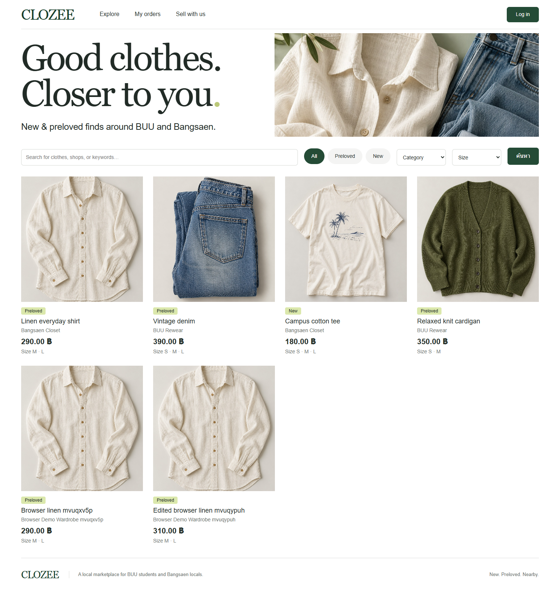

# CLOZEE

**Local Clothing Marketplace & Delivery Platform** — ระบบซื้อขายเสื้อผ้าใหม่และมือสองสำหรับ BUU และบางแสน  
89022167 Database Management · Final round target: **10 November 2026**

**Local implementation and tests pass. NOT READY TO SUBMIT until the Angsila deployment is authorized and verified.** The user signed in to phpMyAdmin personally and authorized read-only environment inspection. No live database writes or uploads have occurred; no Google Sheets passwords were read or used.

Angsila has existing Lab tables. Configure private `table_prefix = clozee_` and review [shared database tests](docs/shared-database-tests.md) and [deployment status](docs/deployment-verification.md) before installation. Local regression now passes 51 database/domain checks and 24 browser checks for both default and prefixed tables. The linked CI run below verifies the preceding code revision.

Source: [Skyce38/CLOZEE](https://github.com/Skyce38/CLOZEE) · [Verified MySQL CI run](https://github.com/Skyce38/CLOZEE/actions/runs/41034821401) · [Course requirements](docs/course-requirements.md) · [Final report](docs/CLOZEE-Final-Report-Round2.pdf)



## Features

- Register/login/logout, hashed passwords, session rotation/expiry, CSRF and owner-scoped operations.
- One shop per account; shop create/edit/deactivate; clothing product CRUD with sizes, price, stock and stale-edit protection.
- Search/filter new/preloved, category and size; product/shop details; single-shop server-side cart.
- Atomic checkout, idempotent retries, stock row locks, pickup/delivery, server-calculated fee, immutable item snapshots.
- Seller-only validated status transitions, cancellation restocking once, status audit and private buyer history.
- Participant-only text chat with manual refresh, mobile/desktop UI and bundled original demo photographs.

No payment gateway, drivers/GPS, real courier integration, refunds, BUU SSO or customer-image upload. Multiple images and sales analytics remain deferred. Products with order history deactivate instead of being physically deleted. See [implementation decisions](docs/implementation-decisions.md).

## Requirements

- PHP **8.1+**, extensions `pdo_mysql`, `mbstring`, `session`.
- MySQL **8.0.16+** or MariaDB **10.6+**, InnoDB/utf8mb4 with enforced CHECK constraints. Actual tests: PHP 8.5.12/MariaDB 11.4.9 locally; PHP 8.3.36/MySQL 8.4.13 on CI. Angsila runtime remains unknown.
- Apache pointing to `public/`, or PHP development server for local use.
- Node.js **22+** is needed only for optional browser tests/diagram/PDF tooling; production is PHP only. Python 3 is needed only to regenerate documentation from metadata.

## Install locally

1. Clone into a directory OUTSIDE your public webroot:

   ```sh
   git clone https://github.com/Skyce38/CLOZEE.git
   cd CLOZEE
   ```

2. Create a new, dedicated EMPTY database using an authorized local administrator account. Do not reuse a database with important data. Example SQL contains no credentials:

   ```sql
   CREATE DATABASE clozee CHARACTER SET utf8mb4 COLLATE utf8mb4_unicode_ci;
   ```

3. Copy `app/config/example.php` to `app/config/local.php`. Fill in your private local connection configuration. `local.php` is ignored by Git and MUST remain outside `public/`. For local HTTP only, set `secure_cookies` to `false`; HTTPS deployments keep it `true`.

   Environment overrides: `CLOZEE_DB_HOST`, `CLOZEE_DB_PORT`, `CLOZEE_DB_NAME`, `CLOZEE_DB_USER`, `CLOZEE_DB_PASS`, `CLOZEE_BASE_PATH`, `CLOZEE_DELIVERY_FEE`, `CLOZEE_SECURE_COOKIES` (`1` or local-only `0`). The app does not automatically load `.env` files. `base_path` is empty at localhost root, or the deployed subdirectory prefix with no trailing slash.

4. Import schema into the selected empty DB with phpMyAdmin, or use the CLI guard:

   ```sh
   php scripts/migrate.php --empty-database
   php scripts/seed.php --demo-only
   php scripts/doctor.php
   ```

   `migrate.php` refuses any database containing existing tables. `seed.php` refuses existing users. Neither is an upgrade/reset script. The schema does not CREATE/DROP a database. DDL can auto-commit, so stop and review a failed import rather than rerunning over existing tables.

   Seed uses fictional `example.test` accounts, 3 shops, 4 products and 10 variants. It generates fresh demo passwords into **`storage/demo-accounts.json`**, outside public and ignored by Git. Read that private file locally to try the demo; do not upload/share/commit it. Never use actual user/password sheets. For production, skip the demo seed.

5. Start a local server, leaving the terminal running:

   ```sh
   php -S 127.0.0.1:8088 -t public
   ```

   Open [localhost CLOZEE](http://127.0.0.1:8088/). PHP's development server is for local testing, not public production hosting.

## Demonstrate the project

Register a fictional buyer and a second account for a seller. Seller: Sell with us → create shop → add a product/size/price/stock. Buyer: Explore → product → cart → pickup/delivery checkout → private order. Seller: received orders → confirm/prepare/ready or delivery/complete. Demonstrate an unused product's DELETE, cancellation once and a size-question chat. Try the other account's product/order URL to show ownership rejection. See [manual tests](docs/manual-tests.md).

The default primary images are bundled demo choices. File upload is not implemented. Local delivery is a record for seller coordination, not a courier service. Buyer/seller arrange payment directly.

## Tests

Create another EMPTY database whose name contains `test`, using an account with permissions only on your dedicated local databases. Tests never target production. They add fictional fixtures and preserve earlier test runs; no automatic DROP/reset.

PowerShell:

```powershell
$env:CLOZEE_TEST_DB = 'clozee_test'
php tests/run.php
```

Bash:

```sh
CLOZEE_TEST_DB=clozee_test php tests/run.php
```

This suite imports schema only if the test DB is empty and exercises real PDO/FK/transactions plus two independent PHP processes for stock/idempotency races. Current local result: **47 passed, 0 failed**.

Browser tests require a running loopback demo instance and create fictional users/products/orders in that demo DB:

```sh
npm ci
npm run test:browser
```

Default browser is installed Google Chrome. To use bundled Chromium, run `npx playwright install chromium`, then set `CLOZEE_BROWSER_CHANNEL=chromium`. `CLOZEE_URL` defaults to `http://127.0.0.1:8088` and tests reject non-loopback URLs. Current local result: **24 passed, 0 failed**; tested at 1536×1024, 1440×1000 and 390×844. [Results and limitations](docs/test-results.md).

GitHub Actions runs PHP 8.3, MySQL 8.4 and Chromium in isolated CI. The blank-root setting in the CI service is solely for its temporary disposable database, never production. Inspect the workflow for the exact version/commit and check the latest run before submission. Uploaded evidence excludes private config and demo credentials.

## Documents and SQL evidence

- [Course requirements and page references](docs/course-requirements.md)
- [Final report source](docs/final-report.md), [PDF](docs/CLOZEE-Final-Report-Round2.pdf), [offline HTML](docs/final-report.html)
- [ER Diagram](docs/diagrams/er-diagram.svg), [Use Case Diagram](docs/diagrams/use-cases.svg), [Architecture](docs/diagrams/architecture.svg), [Status flow](docs/diagrams/order-status.svg)
- [75-field Data Dictionary](docs/data-dictionary.md), [Use cases](docs/use-cases.md)
- [Executable JOIN examples](database/demo-joins.sql), [actual JOIN results](docs/sql-join-evidence.md)
- [Angsila guide](docs/deployment.md), [verification record](docs/deployment-verification.md), [submission audit](docs/final-submission-checklist.md)

Regeneration (after executing tests on a fictional local demo):

```sh
php scripts/export-metadata.php
python scripts/build-docs.py
node scripts/render-diagrams.cjs
node scripts/print-report.cjs
```

The report uses actual schema/test JSON and screenshots. Do not regenerate it from guessed results. Cover placeholders remain for the author's full name, other members and instructor; student ID 68160207/course details were supplied by the user. Archive/reference planning files record the earlier design, not the current readiness state.

## Deployment and privacy

Follow [deployment.md](docs/deployment.md). No actual Angsila target, directory, transfer method or runtime is known yet. Do not deploy or use credentials until the user verifies the target and approves. Only `public/` may be web-visible; never serve app/config, SQL, storage, tests, scripts, reports or setup files publicly. Runtime DB account needs DML only; use a separate authorized setup account for schema changes. Keep production errors/logs private and HTTPS Secure cookies enabled.

Source is versioned on GitHub; private `local.php`, runtime logs, generated passwords and DB dumps are excluded. [Design reference](docs/design-system.md) is separate from screenshots of the running application.
