# CLOZEE

## Local Clothing Marketplace & Delivery Platform

ระบบซื้อขายและจัดส่งเสื้อผ้ามือหนึ่งและมือสองสำหรับนิสิตมหาวิทยาลัยบูรพาและคนในพื้นที่บางแสน

**รายงาน Final Project รอบ 2**  
รายวิชา 89022167 Database Management  
มหาวิทยาลัยบูรพา คณะวิทยาการสารสนเทศ  
รหัสนิสิต: **68160207**  
ผู้จัดทำ: **[ยังไม่ได้รับชื่อ–นามสกุล]**  
สมาชิกเพิ่มเติม: **[ยังไม่ได้รับข้อมูลสมาชิกอื่น หรือการยืนยันว่าทำเดี่ยว]**  
อาจารย์ผู้สอน: **[ยังไม่ได้รับชื่ออาจารย์]**  
กำหนดส่ง: **10 พฤศจิกายน 2569**  
จัดทำหลักฐานการพัฒนา: 30 ตุลาคม 2569 
ปรับปรุงรายงานและชุดส่งงาน: 31 ตุลาคม 2569

**สถานะ: ระบบ Local, MySQL CI และระบบหลักบน Angsila ผ่านการตรวจแล้ว; ยังต้องเติมข้อมูลหน้าปกและยืนยันรายละเอียดการส่งก่อนส่งฉบับสมบูรณ์ การเข้าถึงนอก VPN ยังไม่ยืนยัน**

## 1 บทนำและ Problem Statement

นิสิต BUU และคนในบางแสนอาจซื้อขายเสื้อผ้าใหม่/มือสองผ่านหลายช่องทาง ทำให้ข้อมูลไซซ์ สภาพ สต็อก และจุดนัดรับกระจัดกระจาย CLOZEE เสนอพื้นที่เดียวสำหรับค้นหาเสื้อผ้าท้องถิ่น เปิดร้าน จัดการตัวเลือกไซซ์ สั่งซื้อ และบันทึกวิธีรับสินค้า แนวปัญหานี้เป็นสมมติฐานของโครงการจาก project-spec มิใช่ผลสำรวจหรือข้อมูลสัมภาษณ์ที่ได้ทำจริง

วัตถุประสงค์คือประยุกต์ PHP และฐานข้อมูลเชิงสัมพันธ์ให้ผู้ซื้อเลือกเสื้อผ้าและเห็นสถานะ ส่วนผู้ขายควบคุมข้อมูลและสต็อกของร้านตนเอง พร้อมแสดงหลักฐาน CRUD, Authentication, Authorization, JOIN และ transaction ตามเนื้อหารายวิชา

กลุ่มเป้าหมายคือผู้ซื้อที่เป็นนิสิตมหาวิทยาลัยบูรพาและคนในบางแสน และผู้ขายรายย่อย/ร้านเสื้อผ้าในพื้นที่ บัญชีเดียวเป็นผู้ซื้อและเปิดร้านได้หนึ่งร้าน ไม่มีการยืนยันสถานภาพนิสิตหรือกำหนด BUU SSO ในรุ่นนี้

## 2 ขอบเขตและ Requirements

P0 ประกอบด้วยบัญชีผู้ใช้ ร้านค้า สินค้าใหม่/มือสอง ไซซ์ ราคา สต็อก ค้นหา/กรอง ตะกร้าร้านเดียว คำสั่งซื้อ นัดรับ/จัดส่ง ประวัติและการเปลี่ยนสถานะ P1 ที่ทำเพิ่มหลังทดสอบระบบหลักคือแชทข้อความ ส่วนหลายรูปและรายงานยอดขายยังไม่ได้ทำ

การจัดส่งเป็นการบันทึกตัวเลือกและรายละเอียดเพื่อให้ร้านดำเนินการโดยตรง ค่าจัดส่งตัวอย่างตั้งที่ server 30 บาทต่อ order; นัดรับฟรี ไม่มีระบบรับเงินออนไลน์ rider dispatch, GPS, shipping API, refund/dispute, rating หรือ checkout หลายร้าน

| ID | Requirement | Implementation |
| --- | --- | --- |
| FR-01/02 | สมัคร/เข้าสู่ระบบ/ออกจากระบบ | Register, hash/verify, session, guard, POST+CSRF logout |
| FR-03 | ร้านของผู้ใช้ | สร้างและแก้ไขร้านหนึ่งร้านต่อบัญชี |
| FR-04/05 | สินค้า/ไซซ์/ราคา/สต็อก | C/R/U, deactivate และ DELETE เฉพาะสินค้ายังไม่มีประวัติ; version กัน stale stock |
| FR-06/07 | ค้นหา/กรอง/รายละเอียด | GET filters condition/category/size/query, product/shop pages |
| FR-08/09 | checkout ร้านเดียว/นัดรับ/จัดส่ง | server cart, row locks, idempotency, snapshots, server fee |
| FR-10/11 | สถานะ/ประวัติ | shop owner state machine, buyer-owned history, status audit |
| FR-12 | ตรวจสิทธิ์ทุก mutation | actor จาก session; scoped DB checks; tests สองบัญชี |
| FR-13 | ข้อความผู้ซื้อ–ร้าน | ทำแล้ว: participant-only text chat, manual refresh |
| FR-14/15 | หลายรูป/สรุปยอดขาย | ยังไม่ทำ เป็น P1 ที่เลื่อนได้ |

NFR เน้น prepared statements, output escaping, CSRF, session/cookie, ownership, FK/unique/check, atomic transactions และ responsive design ดู functional-requirements.md และ implementation-decisions.md รายละเอียดครบ

ข้อกำหนดอาจารย์อ้าง `Database-authen.pdf` หน้า 31–36 โดยเฉพาะหน้า 33 องค์ประกอบขั้นต่ำ หน้า 34 วันส่ง หน้า 35 รายงาน หน้า 36 checklist ไม่ใช้เกณฑ์คะแนน Lab แทน Final ดู course-requirements.md สำหรับ traceability

## 3 Use Cases และสิทธิ์

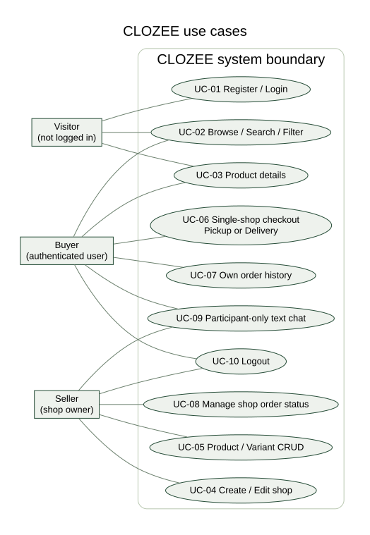

ผู้เยี่ยมชมค้นหา/ดูสินค้าและสมัครสมาชิก ผู้ซื้อ checkout ดูประวัติของตนและคุยกับร้าน ผู้ขายสร้าง/แก้ร้านและสินค้า ดู order ของร้านและเปลี่ยนสถานะ บัญชีเดียวเล่นบทบาท buyer/seller ได้ตามบริบท ไม่ใช่ role ที่ผู้ใช้ส่งมาแล้วได้รับสิทธิ์เอง

UC-06 flow: login → เลือกไซซ์และจำนวน → cart ร้านเดียว → เลือก pickup/delivery และข้อมูลจำลอง → server ตรวจราคา/stock/สิทธิ์ → transaction lock → สร้าง order/items/snapshots → ลด stock และ audit → commit → แสดง order เฉพาะผู้มีสิทธิ์ ถ้า stock ไม่พอหรือผิดร้านจะ rollback ทั้งชุด

UC-05 flow: เจ้าของร้าน login → เพิ่มสินค้าพร้อม variants → อ่าน/แก้ไขข้อมูล → ปิดขายหรือ DELETE เฉพาะรายการที่ไม่มีประวัติการซื้อ การเปลี่ยน ID ของร้านอื่นต้องถูกปฏิเสธ

## 4 ER Diagram และการออกแบบฐานข้อมูล

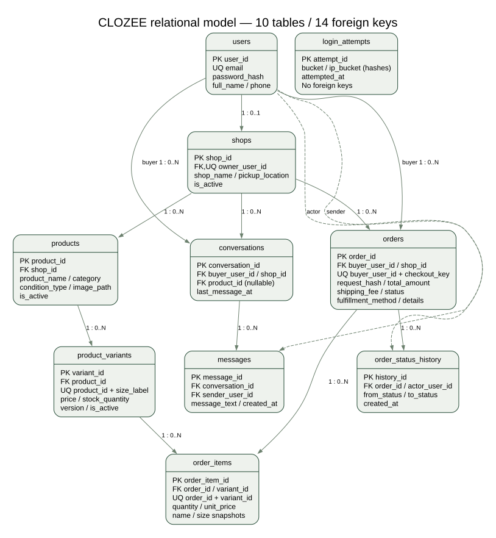

โมเดลจริงมี **10 ตาราง 75 คอลัมน์ 14 Foreign Keys** รวม users, shops, products, product_variants, orders, order_items, conversations, messages, order_status_history และ login_attempts ใช้ InnoDB/utf8mb4, BIGINT UNSIGNED สำหรับคีย์ และ DECIMAL สำหรับเงิน

users 1:0..1 shops บังคับด้วย UNIQUE owner; shops 1:N products/orders; products 1:N variants; orders 1:N items; variants 1:N historical items; conversations 1:N messages; order 1:N status history ส่วน login_attempts เป็นข้อมูลจำกัดการลอง login ชั่วคราวที่ไม่ผูก FK กับผู้ใช้ เพราะคำขออาจไม่ใช่บัญชีจริง

ER แสดง cardinality ที่ schema อนุญาต (0..N) แต่ service บังคับสินค้าต้องมีอย่างน้อยหนึ่ง variant และ order อย่างน้อยหนึ่ง item ภายใน transaction FK product ของ conversation เป็น nullable และ SET NULL เมื่อสินค้าไม่มีแล้ว ส่วนประวัติคำสั่งซื้อใช้ RESTRICT ป้องกันการทำลายความสัมพันธ์

## 5 Architecture และ Project Structure

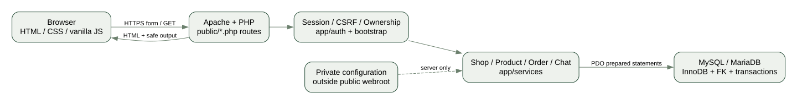

Browser ได้ HTML/CSS/vanilla JS จาก PHP หลัง Apache ประมวลผล route ใน public/ ทุก mutation ผ่าน session/CSRF และ service ที่ตรวจ ownership แล้วใช้ PDO native prepared statements ติดต่อ MySQL/MariaDB config และ storage อยู่ภายนอก webroot ไม่มี password บน browser หรือ repo

public/ แยก route สำหรับ catalog/auth/shop/product/cart/checkout/orders/messages และ seller ส่วน app/ มี bootstrap, validation, auth, services และ templates; database/ เก็บ schema/seed/JOIN; scripts/ ใช้ CLI ติดตั้งและตรวจ; docs/ เก็บรายงานและหลักฐาน Node/Python ใช้เฉพาะ test/document tooling ไม่ต้องใช้ขณะเสิร์ฟ PHP

## 6 การทำงานจริงและ UI

หน้าร้านใช้สีขาว/เขียว สไตล์ editorial ภาพสินค้าเป็นภาพสาธิตสร้างใหม่ มิใช่สินค้า/ลูกค้าจริง รูปด้านล่างเป็น screenshot จากเว็บ PHP ที่รันจริง แยกจาก design concept ซึ่งไม่ใช้เป็นหลักฐานทดสอบ

### 6.1 หน้าร้านและมือถือ

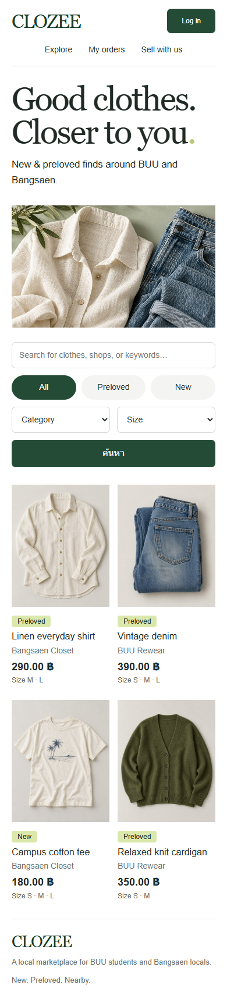

### 6.2 Login และ Product CRUD

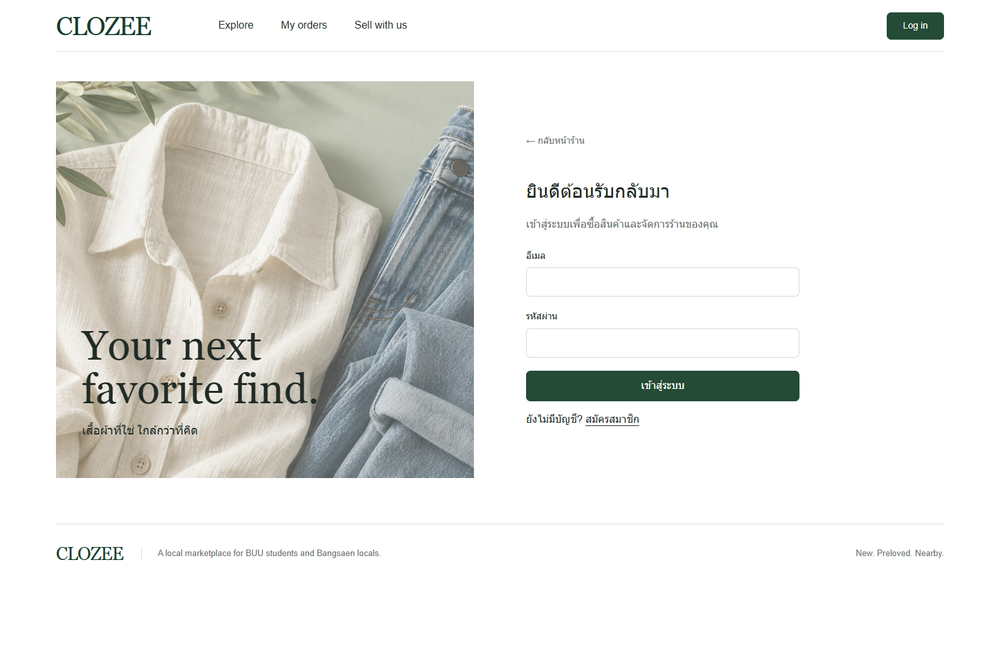

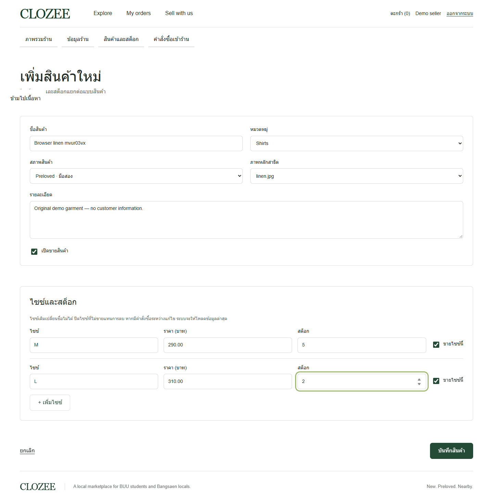

Create/Read/Update persist ลง DB จริง ส่วน DELETE สินค้าที่ไม่มีประวัติทดสอบใน service suite ถ้ามี order อ้างอิงจะปฏิเสธและใช้ deactivate แทน

### 6.3 Checkout และสถานะ

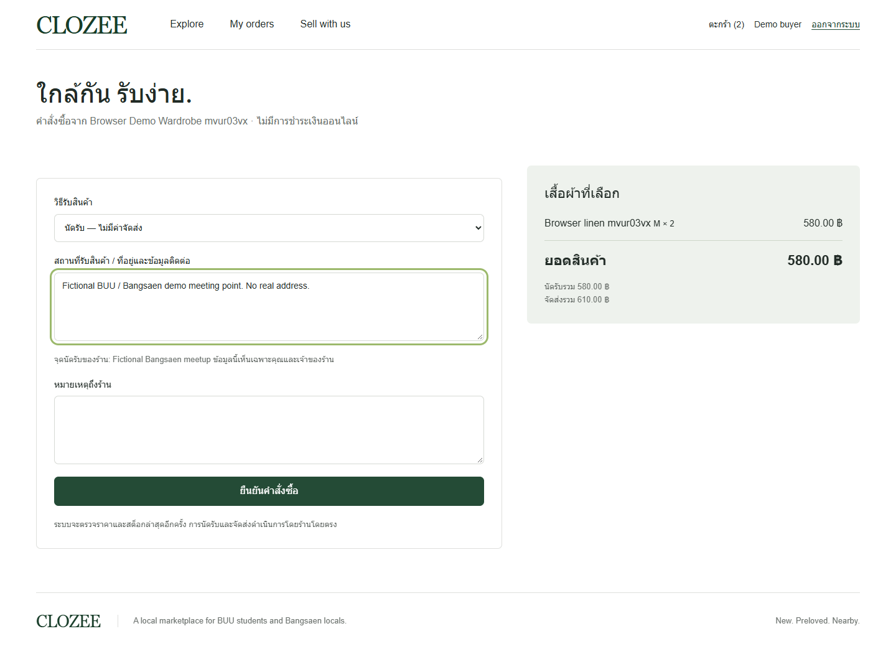

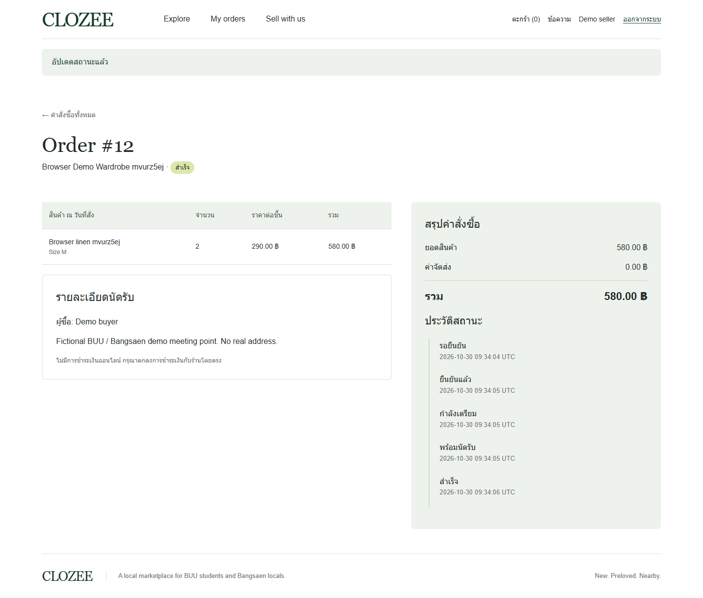

ข้อมูลนัดรับ/ที่อยู่ในหลักฐานเป็นข้อความจำลอง ไม่มีข้อมูลผู้ซื้อจริง

### 6.4 แชทข้อความ

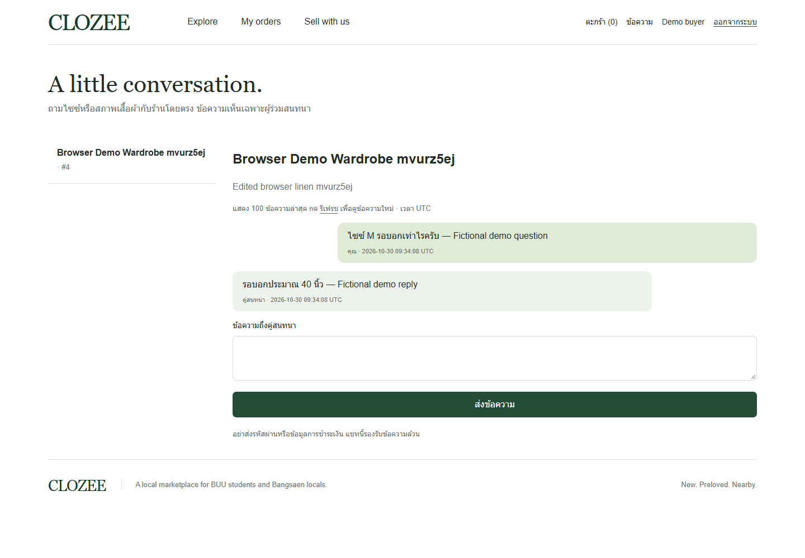

เริ่มจากหน้าสินค้า ใช้ thread เดิมของ buyer/product คู่เดิม ส่งได้เฉพาะ buyer หรือเจ้าของร้าน แสดงล่าสุด 100 ข้อความและ refresh ด้วยตนเอง ไม่มีการอ้างว่า realtime

## 7 CRUD และ Data Integrity

ProductService ทำ CREATE/UPDATE product+variants ใน transaction, ตรวจเจ้าของร้านจาก session, ราคา/ไซซ์/stock จาก server และ version ของ variant หาก checkout เปลี่ยน stock ระหว่างเปิด form จะปฏิเสธ stale edit

OrderService ใช้ lock ตาม buyer → shop → products → variants; ตรวจร้าน/สินค้ายัง active และ stock อีกครั้ง; สร้าง order/items และลด stock/audit พร้อมกัน เงินคิดเป็นสตางค์ integer ก่อนบันทึก DECIMAL request key unique ต่อผู้ซื้อและ payload hash กัน retry ที่ไม่ตรงกัน ทำให้ส่งซ้ำไม่หัก stock ซ้ำ

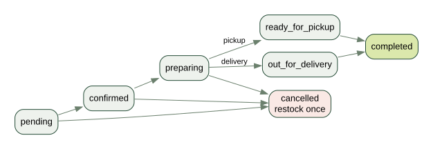

Seller เปลี่ยนสถานะตามวิธีรับสินค้าเท่านั้น Cancel อนุญาตก่อนพร้อมรับ/ออกส่งและคืน stock ครั้งเดียวภายใต้ order lock Terminal states เปลี่ยนซ้ำไม่ได้ snapshots ชื่อ/ไซซ์/ราคายังคงเดิมเมื่อแก้ product

## 8 SQL JOIN และผลจริง

ตัวอย่าง SQL อยู่ใน database/demo-joins.sql และผลรันอยู่ sql-join-evidence.md / evidence/join-results.json INNER JOIN เชื่อมผู้ซื้อ–order–ร้าน–snapshot items ส่วน LEFT JOIN คงร้านที่ไม่มี order โดยใช้ COUNT(o.order_id) ไม่ใช่ COUNT(*)

| Order | Buyer | Shop | Item | Qty |
| --- | --- | --- | --- | --- |
| 1 | Demo buyer | Browser Demo Wardrobe mvuqxv5p | Browser linen mvuqxv5p | 2 |
| 2 | Demo buyer | Browser Demo Wardrobe mvuqypuh | Browser linen mvuqypuh | 2 |
| 3 | Demo buyer | Browser Demo Wardrobe mvuqypuh | Browser linen mvuqypuh | 1 |
| 4 | Demo buyer | Browser Demo Wardrobe mvur03vx | Browser linen mvur03vx | 2 |

| Shop | Order count |
| --- | --- |
| Bangsaen Closet | 0 |
| BUU Rewear | 0 |
| The Next Wardrobe | 0 |

JOIN หนึ่งต่อหลายเพิ่มจำนวนแถวได้ จึงไม่ SUM(total_amount) หลัง JOIN items โดยตรง Product catalog aggregate variants ให้เหลือหนึ่งแถวต่อ product ก่อน pagination หลักการอ้าง Data-base-join.pdf หน้า 9, 16, 28–30

## 9 Authentication และ Security

ใช้ password_hash/password_verify, normalized unique email, session_regenerate_id หลัง login/register, strict session mode และ idle timeout 30 นาที Cookie มี HttpOnly/SameSite=Lax; Secure default true แต่ปิดเฉพาะ Local HTTP การตรวจ HTTPS บน Angsila ยืนยัน Secure/HttpOnly/SameSite=Lax และ no-store แล้ว ไม่มีการส่งออก cookie value หรือรหัสผ่าน

ทุก form เปลี่ยนข้อมูลรวม logout ใช้ POST+CSRF ทุกคำสั่ง SQL รับค่าผ่าน prepared statements Escape output ด้วย htmlspecialchars CSP จำกัด source ของ asset/form และห้าม framing DB errors ไม่เผยต่อผู้ใช้ ผู้ใช้ A ถูกตรวจทั้ง URL และ POST ว่าแก้ข้อมูล B ไม่ได้

จำกัด login ผิดจาก bucket account+IP และ IP ในช่วง 15 นาที เก็บ hash ไม่เก็บรหัสผ่าน/IP ดิบ private config และ demo passwords ถูก gitignore และอยู่นอก public การทดสอบใช้บัญชี example.test ที่สร้างขึ้นเท่านั้น ไม่อ่านหรือใช้ชีต User/Password

## 10 Testing และผลที่ได้

Local: **51 / 51 domain/database/concurrency tests ผ่าน**, **24 / 24 browser tests ผ่าน** Environment PHP 8.5.12, 11.4.9-MariaDB, installed Chrome via Playwright ที่ desktop และ 390×844

CI: [GitHub Actions run 41064936461](https://github.com/Skyce38/CLOZEE/actions/runs/41064936461) ยืนยัน PHP 8.3.36 + MySQL 8.4.13 และ Chromium ขั้น syntax/schema/seed, domain/concurrency และ browser ผ่านสำหรับ commit `f3342a0` หลักฐานแยก revision ชัดเจน ไม่ใช้ CI เก่าอ้างว่า commit ใหม่ผ่านอัตโนมัติ

Concurrency test ใช้สอง PHP processes เชื่อม DB อิสระแย่งซื้อ item ชิ้นสุดท้าย ผลสำเร็จเพียงหนึ่งคำขอ stock เหลือศูนย์ ส่วนสองคำขอ key เดียวได้ order เดียว stock ลดครั้งเดียว ทดสอบ rollback, stale edit, cancel คืน stock, snapshot, ownership, CSRF, SQL injection และ XSS chat เพิ่มด้วย

Angsila: ตรวจผ่าน 30 functional checkpoints และ 17 anonymous HTTP/security checks พร้อม fresh-browser desktop/mobile capture ระบบนัดรับ Order #1 สำเร็จ ยกเลิกจัดส่ง Order #2 คืนสต็อก และจัดส่ง Order #3 สำเร็จ ทดสอบสิทธิ์ข้ามบัญชี แชท และ snapshot ด้วยข้อมูล QA สมมติ รายละเอียดใน test-results.md และ JSON evidence/ การทดสอบนี้ไม่ใช่ penetration/load test; concurrency และ physical DELETE ผ่านใน isolated DB/CI แต่ไม่ได้ทำซ้ำบน live

## 11 Deployment และสถานะส่งงาน

Repository: [Skyce38/CLOZEE](https://github.com/Skyce38/CLOZEE)  
Local URL: http://127.0.0.1:8088 (เฉพาะเครื่องพัฒนา ไม่ใช่ URL ส่งงาน)  
Angsila URL: **https://angsila.informatics.buu.ac.th/~68160207/clozee/**

ผู้ใช้ยืนยันว่าต้องเปิด VPN มหาวิทยาลัย และล็อกอิน phpMyAdmin/FileZilla ด้วยตนเอง จากนั้นอนุมัติปลายทางและแผน SQL ก่อนเขียนจริง แยก public_html/clozee ออกจาก clozee-private นอกเว็บ ใช้ฐาน s68160207 โดยสร้างเฉพาะตาราง clozee_ 10 ตาราง เก็บตาราง Lab เดิมทั้งห้าไว้ครบ รหัสผ่านกรอกโดยผู้ใช้ในไฟล์ส่วนตัวที่ Git ไม่ติดตามและไม่อยู่ใน public_html ไม่อ่านหรือใช้รหัสผ่านจาก Google Sheets

ตรวจ schema จริงได้ 75 คอลัมน์, 14 Foreign Keys, 5 enforced CHECK; หน้าเว็บ PHP/PDO เชื่อมต่อและทำงานกับ MySQL 8.0.46 ได้จริง HTTP protection ผ่านและเว็บ Lab เดิมยังเปิดได้ ดู deployment-verification.md สำหรับหลักฐานและขอบเขตการตรวจ การเปิดด้วยเบราว์เซอร์ใหม่ผ่านในเครือข่าย/VPN เดียวกัน ไม่อ้างว่าทดสอบจากอินเทอร์เน็ตภายนอก VPN แล้ว

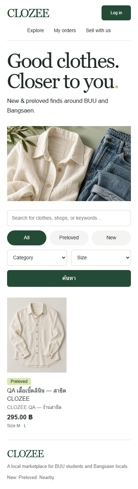

## 12 ข้อจำกัดและงานที่ยังต้องทำ

ต้องเติมข้อมูลหน้าปกที่ยังไม่ทราบและยืนยันช่องทางส่ง/slot นำเสนอ; ไม่ยืนยัน off-VPN reachability หรือ restore backup; รูปสินค้าเป็นชุดภาพสาธิต ไม่มี customer upload/multiple images; chat ไม่ realtime; order/thread/shop listing จำกัดล่าสุดไม่เกิน 100; ไม่มี analytics dashboard, payment, courier, GPS, refunds หรือ BUU SSO; pain point ยังเป็นสมมติฐาน ไม่อ้างการวิจัยจริง

ก่อนส่งจริงต้องเติมชื่อผู้จัดทำ/สมาชิก/อาจารย์ ตรวจ URL ผ่าน VPN อีกครั้ง และยืนยันช่องทางส่ง/slot นำเสนอกับอาจารย์ เพราะสไลด์ที่ให้ไม่ได้กำหนดรายละเอียดเหล่านี้ ห้ามส่งไฟล์ config หรือรหัสผ่านใน ZIP/GitHub บัญชี ร้าน สินค้า และคำสั่งซื้อ QA เป็นข้อมูลสมมติ มิใช่การซื้อขายจริง

## 13 แหล่งอ้างอิง

- Database-authen.pdf หน้า 31–36: Final Project; หน้า 5–18: CRUD/Auth/Security
- CRUD-and-VERSION-CONTROL.pdf หน้า 3–17, 22–36: PHP/MySQL/Git/Angsila
- Data-base-join.pdf หน้า 4–5, 8–30: relational keys/JOIN/debug
- CLOZEE-round2-kit.zip: round2-build-brief, project-spec, functional-requirements, use-cases, final-report-outline
- [PHP PDO prepared statements](https://www.php.net/manual/en/pdo.prepared-statements.php)
- [MySQL InnoDB locking reads](https://dev.mysql.com/doc/refman/8.0/en/innodb-locking-reads.html)
- GitHub source/CI และหลักฐานที่รันจริงใน docs/evidence; ไม่มีการคัดลอกโปรเจกต์ Resume/อาหารเป็น CLOZEE

## ภาคผนวก Data Dictionary

สร้างจาก information_schema ของ schema ที่นำเข้าจริงบน MariaDB 11.4.9 ไม่ใช่การเดาจากชื่อฟิลด์ รวม 10 ตาราง 75 คอลัมน์ 14 Foreign Keys เวลาในฐานข้อมูลเป็น UTC ส่วน UI ระบุ UTC ไว้ชัดเจน

## conversations

| Column | Type | NULL? | Default | Key / rule | Meaning |
| --- | --- | --- | --- | --- | --- |
| conversation_id | bigint(20) unsigned | NO | NULL | PRI; auto_increment | รหัสการสนทนา |
| buyer_user_id | bigint(20) unsigned | NO | NULL | MUL; FK → users.user_id | บัญชีผู้ซื้อ |
| shop_id | bigint(20) unsigned | NO | NULL | MUL; FK → shops.shop_id | รหัสร้าน |
| product_id | bigint(20) unsigned | YES | NULL | MUL; FK → products.product_id | รหัสสินค้า |
| created_at | timestamp | NO | current_timestamp() | - | เวลาสร้าง (UTC) |
| last_message_at | timestamp | YES | NULL | - | เวลาข้อความล่าสุด ใช้เรียง thread |

## login_attempts

| Column | Type | NULL? | Default | Key / rule | Meaning |
| --- | --- | --- | --- | --- | --- |
| attempt_id | bigint(20) unsigned | NO | NULL | PRI; auto_increment | รหัสบันทึกการล็อกอินผิด |
| bucket | char(64) | NO | NULL | MUL | SHA-256 ของ IP + normalized email |
| ip_bucket | char(64) | NO | NULL | MUL | SHA-256 ของ IP เพื่อจำกัดการลองรวม |
| attempted_at | timestamp | NO | current_timestamp() | - | เวลา login ผิด เก็บชั่วคราว |

## messages

| Column | Type | NULL? | Default | Key / rule | Meaning |
| --- | --- | --- | --- | --- | --- |
| message_id | bigint(20) unsigned | NO | NULL | PRI; auto_increment | รหัสข้อความ |
| conversation_id | bigint(20) unsigned | NO | NULL | MUL; FK → conversations.conversation_id | รหัสการสนทนา |
| sender_user_id | bigint(20) unsigned | NO | NULL | MUL; FK → users.user_id | ผู้ส่งจริงจาก session |
| message_text | text | NO | NULL | - | ข้อความล้วน 1–2000 ตัวอักษร Escape เมื่อแสดงผล |
| created_at | timestamp | NO | current_timestamp() | - | เวลาสร้าง (UTC) |

## orders

| Column | Type | NULL? | Default | Key / rule | Meaning |
| --- | --- | --- | --- | --- | --- |
| order_id | bigint(20) unsigned | NO | NULL | PRI; auto_increment | รหัสคำสั่งซื้อ |
| buyer_user_id | bigint(20) unsigned | NO | NULL | MUL; FK → users.user_id | บัญชีผู้ซื้อ |
| shop_id | bigint(20) unsigned | NO | NULL | MUL; FK → shops.shop_id | รหัสร้าน |
| fulfillment_method | enum('pickup','delivery') | NO | NULL | - | pickup หรือ delivery |
| fulfillment_details | text | NO | NULL | - | สถานที่และรายละเอียดส่วนตัวที่ผู้ซื้อให้ร้าน |
| shipping_fee | decimal(10,2) | NO | 0.00 | - | ค่าจัดส่ง ณ เวลาสั่งซื้อ |
| total_amount | decimal(10,2) | NO | NULL | - | ผลรวมสินค้าและค่าจัดส่งจาก server |
| status | enum('pending','confirmed','preparing','ready_for_pickup','out_for_delivery','completed','cancelled') | NO | 'pending' | - | สถานะปัจจุบันตาม state machine |
| buyer_note | text | YES | NULL | - | หมายเหตุถึงร้าน |
| checkout_key | char(64) | NO | NULL | - | รหัสกันคำขอซ้ำ ไม่ซ้ำร่วมกับ buyer_user_id |
| request_hash | char(64) | NO | NULL | - | SHA-256 ของคำขอเพื่อป้องกันใช้ key เดิมกับข้อมูลอื่น |
| created_at | timestamp | NO | current_timestamp() | - | เวลาสร้าง (UTC) |
| updated_at | timestamp | NO | current_timestamp() | -; on update current_timestamp() | เวลาแก้ไขล่าสุด (UTC) |

## order_items

| Column | Type | NULL? | Default | Key / rule | Meaning |
| --- | --- | --- | --- | --- | --- |
| order_item_id | bigint(20) unsigned | NO | NULL | PRI; auto_increment | รหัสรายการซื้อ |
| order_id | bigint(20) unsigned | NO | NULL | MUL; FK → orders.order_id | รหัสคำสั่งซื้อ |
| variant_id | bigint(20) unsigned | NO | NULL | MUL; FK → product_variants.variant_id | รหัสตัวเลือกไซซ์ |
| product_name_snapshot | varchar(180) | NO | NULL | - | ชื่อสินค้า ณ วันที่สั่ง |
| size_label_snapshot | varchar(50) | NO | NULL | - | ไซซ์ ณ วันที่สั่ง |
| quantity | int(10) unsigned | NO | NULL | - | จำนวน 1–99 |
| unit_price | decimal(10,2) | NO | NULL | - | ราคาต่อหน่วย ณ วันที่สั่ง |

## order_status_history

| Column | Type | NULL? | Default | Key / rule | Meaning |
| --- | --- | --- | --- | --- | --- |
| history_id | bigint(20) unsigned | NO | NULL | PRI; auto_increment | รหัสประวัติสถานะ |
| order_id | bigint(20) unsigned | NO | NULL | MUL; FK → orders.order_id | รหัสคำสั่งซื้อ |
| actor_user_id | bigint(20) unsigned | NO | NULL | MUL; FK → users.user_id | ผู้สร้างคำสั่งซื้อหรือผู้เปลี่ยนสถานะ |
| from_status | varchar(30) | YES | NULL | - | สถานะเดิม NULL สำหรับการสร้างครั้งแรก |
| to_status | varchar(30) | NO | NULL | - | สถานะใหม่ |
| created_at | timestamp | NO | current_timestamp() | - | เวลาสร้าง (UTC) |

## products

| Column | Type | NULL? | Default | Key / rule | Meaning |
| --- | --- | --- | --- | --- | --- |
| product_id | bigint(20) unsigned | NO | NULL | PRI; auto_increment | รหัสสินค้า |
| shop_id | bigint(20) unsigned | NO | NULL | MUL; FK → shops.shop_id | รหัสร้าน |
| product_name | varchar(180) | NO | NULL | - | ชื่อสินค้าในปัจจุบัน |
| description | text | YES | NULL | - | รายละเอียดร้านหรือสินค้า |
| category | varchar(80) | YES | NULL | - | หมวดหมู่จากรายการค่าที่อนุญาตใน PHP |
| condition_type | enum('new','secondhand') | NO | NULL | MUL | new หรือ secondhand |
| image_path | varchar(255) | YES | NULL | - | ชื่อภาพสาธิตที่อนุญาตในระบบ |
| is_active | tinyint(1) | NO | 1 | - | 1 เปิดใช้งาน / 0 ปิดใช้งาน |
| created_at | timestamp | NO | current_timestamp() | - | เวลาสร้าง (UTC) |
| updated_at | timestamp | NO | current_timestamp() | -; on update current_timestamp() | เวลาแก้ไขล่าสุด (UTC) |

## product_variants

| Column | Type | NULL? | Default | Key / rule | Meaning |
| --- | --- | --- | --- | --- | --- |
| variant_id | bigint(20) unsigned | NO | NULL | PRI; auto_increment | รหัสตัวเลือกไซซ์ |
| product_id | bigint(20) unsigned | NO | NULL | MUL; FK → products.product_id | รหัสสินค้า |
| size_label | varchar(50) | NO | NULL | - | ไซซ์ ตัวพิมพ์ใหญ่และไม่ซ้ำต่อสินค้า |
| price | decimal(10,2) | NO | NULL | - | ราคาต่อหน่วย DECIMAL; PHP คำนวณเป็นสตางค์ |
| stock_quantity | int(10) unsigned | NO | 0 | - | จำนวนพร้อมขาย 0–999999 |
| version | int(10) unsigned | NO | 1 | - | เลขรุ่นสำหรับป้องกันการแก้สต็อกทับกัน |
| is_active | tinyint(1) | NO | 1 | - | 1 เปิดใช้งาน / 0 ปิดใช้งาน |
| created_at | timestamp | NO | current_timestamp() | - | เวลาสร้าง (UTC) |
| updated_at | timestamp | NO | current_timestamp() | -; on update current_timestamp() | เวลาแก้ไขล่าสุด (UTC) |

## shops

| Column | Type | NULL? | Default | Key / rule | Meaning |
| --- | --- | --- | --- | --- | --- |
| shop_id | bigint(20) unsigned | NO | NULL | PRI; auto_increment | รหัสร้าน |
| owner_user_id | bigint(20) unsigned | NO | NULL | UNI; FK → users.user_id | เจ้าของร้าน หนึ่งร้านต่อบัญชี |
| shop_name | varchar(150) | NO | NULL | - | ชื่อร้าน |
| description | text | YES | NULL | - | รายละเอียดร้านหรือสินค้า |
| pickup_location | varchar(255) | YES | NULL | - | จุดนัดรับที่ร้านระบุ |
| is_active | tinyint(1) | NO | 1 | - | 1 เปิดใช้งาน / 0 ปิดใช้งาน |
| created_at | timestamp | NO | current_timestamp() | - | เวลาสร้าง (UTC) |
| updated_at | timestamp | NO | current_timestamp() | -; on update current_timestamp() | เวลาแก้ไขล่าสุด (UTC) |

## users

| Column | Type | NULL? | Default | Key / rule | Meaning |
| --- | --- | --- | --- | --- | --- |
| user_id | bigint(20) unsigned | NO | NULL | PRI; auto_increment | รหัสบัญชีผู้ใช้ |
| full_name | varchar(120) | NO | NULL | - | ชื่อแสดงผล |
| email | varchar(190) | NO | NULL | UNI | อีเมลไม่ซ้ำ ปรับเป็นตัวพิมพ์เล็กใน PHP |
| password_hash | varchar(255) | NO | NULL | - | รหัสผ่านที่ผ่าน password_hash เท่านั้น |
| phone | varchar(30) | YES | NULL | - | เบอร์โทร (optional; ปัจจุบันไม่ใช้ในฟอร์ม) |
| created_at | timestamp | NO | current_timestamp() | - | เวลาสร้าง (UTC) |
| updated_at | timestamp | NO | current_timestamp() | -; on update current_timestamp() | เวลาแก้ไขล่าสุด (UTC) |

## Unique constraints

| Table | Index | Columns |
| --- | --- | --- |
| conversations | PRIMARY | conversation_id |
| login_attempts | PRIMARY | attempt_id |
| messages | PRIMARY | message_id |
| orders | PRIMARY | order_id |
| orders | uq_order_checkout | buyer_user_id,checkout_key |
| order_items | PRIMARY | order_item_id |
| order_items | uq_order_variant | order_id,variant_id |
| order_status_history | PRIMARY | history_id |
| products | PRIMARY | product_id |
| product_variants | PRIMARY | variant_id |
| product_variants | uq_variants_product_size | product_id,size_label |
| shops | PRIMARY | shop_id |
| shops | uq_shops_owner | owner_user_id |
| users | PRIMARY | user_id |
| users | uq_users_email | email |

## กติกาที่ต้องตรวจใน PHP

ทุก order item ต้องอยู่ในร้านของ order, ผู้ส่งแชทต้องเป็นผู้ร่วมสนทนา, สินค้าต้องมีอย่างน้อยหนึ่ง variant, order ต้องมีอย่างน้อยหนึ่ง item, สต็อกต้องไม่ถูกขายเกิน, state transition ต้องตรงวิธีรับสินค้า และราคาต้องมาจาก server ดู implementation-decisions.md สำหรับ CHECK และ business rules ฉบับเต็ม
