<div class="cover">
<div class="cover-title">รายงานโครงงาน</div>
<div class="cover-title">CLOZEE ระบบซื้อขายเสื้อผ้ามือหนึ่ง</div>
<div class="cover-title">และมือสองในพื้นที่</div>
<div class="cover-sub">(CLOZEE: Local Clothing Marketplace Web Application using PHP and MySQL)</div>
<div class="cover-label">เสนอ</div>
<div>อาจารย์วัชรพงศ์ อยู่ขวัญ</div>
<div class="cover-label">จัดทำโดย</div>
<div>68160197 นายปรัชญาวรินทร์ แสงภู่</div>
<div>68160207 นายเมทนี สีเสน่หา</div>
<div>68160386 นายนันทรัฐ ดีเลิศ</div>
<div class="cover-foot">รายงานนี้เป็นส่วนหนึ่งของวิชา 89022167 Database Management</div>
<div>คณะวิทยาการสารสนเทศ สาขาวิชาปัญญาประดิษฐ์ประยุกต์และเทคโนโลยีอัจฉริยะ</div>
<div>ภาคเรียนที่ 1 ปีการศึกษา 2569</div>
</div>

<div class="front-title">คำนำ</div>

รายงานฉบับนี้เป็นส่วนหนึ่งของวิชา 89022167 Database Management จัดทำขึ้นเพื่อนำเสนอโครงงาน CLOZEE ซึ่งเป็นเว็บแอปพลิเคชันสำหรับซื้อขายเสื้อผ้ามือหนึ่งและมือสอง โดยมีกลุ่มเป้าหมายเป็นนิสิตมหาวิทยาลัยบูรพาและผู้คนในพื้นที่บางแสน

เนื้อหาในรายงานครอบคลุมที่มาของปัญหา ความต้องการของระบบ การออกแบบฐานข้อมูล สถาปัตยกรรม การทำ CRUD การเข้าสู่ระบบ ความปลอดภัย การใช้คำสั่ง SQL JOIN ผลการทดสอบ และข้อจำกัดของระบบ โดยตัวเลขผลทดสอบทั้งหมดมาจากการรันจริงและมีหลักฐานเก็บไว้ใน GitHub Repository

หวังว่ารายงานฉบับนี้จะช่วยให้ผู้อ่านเข้าใจการนำความรู้ด้านฐานข้อมูลเชิงสัมพันธ์ไปใช้กับเว็บแอปพลิเคชันจริง

<div class="front-title front-break">สารบัญ</div>

<!-- TOC -->

## 1. บทนำ

CLOZEE เป็นเว็บแอปพลิเคชันสำหรับซื้อขายเสื้อผ้ามือหนึ่งและมือสองในพื้นที่ ผู้ใช้หนึ่งบัญชีสามารถเป็นทั้งผู้ซื้อและเจ้าของร้านได้หนึ่งร้าน ผู้ขายลงสินค้าพร้อมไซซ์ ราคา สต็อก และรูปภาพ ส่วนผู้ซื้อค้นหาสินค้า สั่งซื้อจากร้านเดียวต่อหนึ่งคำสั่งซื้อ เลือกนัดรับหรือจัดส่งในพื้นที่ และติดตามสถานะคำสั่งซื้อได้

ระบบพัฒนาด้วย PHP และ MySQL ติดตั้งใช้งานจริงบนเซิร์ฟเวอร์ Angsila ของคณะ และเก็บซอร์สโค้ดไว้บน GitHub ผู้ซื้อและผู้ขายตกลงเรื่องการชำระเงินกันโดยตรง เพราะระบบบันทึกเฉพาะคำสั่งซื้อและสถานะ ไม่ได้รับเงินออนไลน์

## 2. ที่มาและปัญหาที่พบ

### 2.1 ที่มาของโครงงาน

ตลาดสินค้ามือสองในประเทศไทยมีแนวโน้มเติบโต โดยผู้บริหารร้านแฟชั่นมือสอง Bagnifique ประเมินกับหนังสือพิมพ์ The Nation เมื่อเดือนกุมภาพันธ์ 2568 ว่าตลาดมีมูลค่าราว 40,000 ล้านบาทในปีก่อนหน้า และมีคนรุ่นใหม่เป็นแรงขับเคลื่อนสำคัญ ตัวเลขนี้เป็นการประเมินของผู้ประกอบการ ไม่ใช่สถิติทางการ แต่ก็สะท้อนว่าเสื้อผ้ามือสองเป็นตลาดที่น่าสนใจ

ในระดับพื้นที่ นิสิตมหาวิทยาลัยบูรพาและผู้คนในบางแสนอยู่ใกล้กันจนสามารถนัดรับสินค้าได้สะดวก โครงงานนี้จึงตั้งคำถามว่า หากมีเว็บไซต์เฉพาะพื้นที่ที่รวมข้อมูลเสื้อผ้าไว้ในที่เดียว การซื้อขายจะง่ายขึ้นหรือไม่

### 2.2 ปัญหาที่พบ

ปัญหาต่อไปนี้เป็นสมมติฐานของโครงงาน ยังไม่ได้สำรวจหรือสัมภาษณ์กลุ่มเป้าหมายจริง

- ข้อมูลกระจัดกระจาย เพราะการซื้อขายเกิดขึ้นในหลายช่องทาง ผู้ซื้อจึงต้องเปิดหาหลายที่
- ผู้ซื้อต้องถามซ้ำหลายครั้งเรื่องไซซ์ สภาพสินค้า และจุดนัดรับก่อนตัดสินใจ
- ผู้ขายรายย่อยไม่มีระบบเดียวสำหรับจัดการสินค้า ไซซ์ สต็อก และสถานะคำสั่งซื้อ
- สินค้ามือสองมักมีจำนวนน้อย ถ้าไม่ตรวจสต็อกให้ดีอาจขายชิ้นเดียวกันซ้ำให้หลายคน

### 2.3 แนวทางแก้ไข

**ตารางที่ 1** ปัญหาและแนวทางที่ระบบเข้าไปแก้ไข

| ปัญหา | แนวทางของ CLOZEE |
| --- | --- |
| ข้อมูลกระจัดกระจาย | รวมสินค้าไว้ในหน้าเดียว ค้นหาและกรองตามสภาพ หมวดหมู่ และไซซ์ได้ |
| ต้องถามข้อมูลซ้ำ | หน้าสินค้าแสดงไซซ์ ราคา รูป รอบอก ความยาว และตำหนิ พร้อมแชทกับร้าน |
| ผู้ขายไม่มีระบบจัดการ | มีหน้าจัดการร้าน สินค้า สต็อก และคำสั่งซื้อ |
| เสี่ยงขายสินค้าซ้ำ | ตัดสต็อกใน Transaction พร้อมล็อกแถวข้อมูล |

## 3. วัตถุประสงค์และขอบเขต

### 3.1 วัตถุประสงค์

- เพื่อออกแบบฐานข้อมูลเชิงสัมพันธ์สำหรับผู้ใช้ ร้านค้า สินค้า ไซซ์ คำสั่งซื้อ และบทสนทนา
- เพื่อพัฒนาการสมัครสมาชิก เข้าสู่ระบบ ออกจากระบบ และการตรวจสิทธิ์ตามความเป็นเจ้าของ
- เพื่อพัฒนาหน้าเว็บที่ทำ CRUD กับ MySQL ได้จริง
- เพื่อให้ผู้ซื้อสั่งซื้อ เลือกวิธีรับสินค้า และติดตามสถานะได้
- เพื่อติดตั้งระบบบน Angsila และทดสอบบนเซิร์ฟเวอร์จริง

### 3.2 กลุ่มเป้าหมาย

ผู้ซื้อคือนิสิตมหาวิทยาลัยบูรพาและผู้คนในบางแสน ส่วนผู้ขายคือนิสิต ผู้ขายเสื้อผ้ามือสอง และร้านเสื้อผ้าขนาดเล็กในพื้นที่ ระบบไม่ได้ตรวจสถานะการเป็นนิสิต

### 3.3 ขอบเขตของระบบ

- หนึ่งบัญชีเปิดได้หนึ่งร้าน และหนึ่งคำสั่งซื้อมีสินค้าจากร้านเดียว
- สินค้าหนึ่งรายการมีได้หลายไซซ์ แต่ละไซซ์มีราคาและสต็อกของตนเอง และมีรูปได้ไม่เกิน 4 รูป
- นัดรับไม่มีค่าใช้จ่าย ส่วนจัดส่งในพื้นที่คิดค่าจัดส่ง 30 บาทต่อคำสั่งซื้อ โดยคำนวณที่เซิร์ฟเวอร์
- การจัดส่งเป็นเพียงการบันทึกตัวเลือกให้ร้านดำเนินการเอง
- ระบบไม่มีการชำระเงินออนไลน์ ไรเดอร์ GPS การเชื่อมต่อบริษัทขนส่ง การคืนเงิน การให้คะแนนร้าน และแอปบนมือถือ

## 4. ทฤษฎีและความรู้ที่เกี่ยวข้อง

### 4.1 สถาปัตยกรรมเว็บและฐานข้อมูล

เมื่อผู้ใช้เปิดหน้าเว็บ เบราว์เซอร์จะส่งคำขอไปยัง Apache จากนั้น PHP จะทำงานที่เซิร์ฟเวอร์ ส่งคำสั่ง SQL ไปยัง MySQL แล้วสร้าง HTML กลับมาแสดงผล ส่วน phpMyAdmin เป็นเพียงเครื่องมือจัดการฐานข้อมูล ไม่ใช่ตัวฐานข้อมูลเอง

### 4.2 ฐานข้อมูลเชิงสัมพันธ์

ฐานข้อมูลเชิงสัมพันธ์เก็บข้อมูลเป็นตาราง Primary Key ใช้ระบุแต่ละแถวไม่ให้ซ้ำ ส่วน Foreign Key ใช้เชื่อมความสัมพันธ์ระหว่างตาราง โครงงานนี้ยังใช้ UNIQUE และ CHECK เพื่อให้ฐานข้อมูลช่วยป้องกันข้อมูลที่ไม่ถูกต้อง

### 4.3 CRUD และ Prepared Statement

CRUD คือการทำงานพื้นฐานกับข้อมูล 4 อย่าง ได้แก่ เพิ่ม อ่าน แก้ไข และลบ ซึ่งตรงกับคำสั่ง INSERT, SELECT, UPDATE และ DELETE ส่วน Prepared Statement แยกคำสั่ง SQL ออกจากค่าที่ผู้ใช้กรอกเพื่อป้องกัน SQL Injection สไลด์รายวิชาสอนด้วย mysqli แต่โครงงานนี้ใช้ PDO ซึ่งมีหลักการเดียวกัน

### 4.4 SQL JOIN

JOIN ใช้รวมข้อมูลจากหลายตาราง INNER JOIN คืนเฉพาะแถวที่จับคู่ได้ ส่วน LEFT JOIN เก็บทุกแถวของตารางซ้ายไว้ แม้ไม่มีข้อมูลที่จับคู่ได้ในตารางขวา ความสัมพันธ์แบบหนึ่งต่อหลายทำให้จำนวนแถวเพิ่มขึ้นได้ จึงต้องระวังเมื่อนับหรือรวมยอดหลัง JOIN

### 4.5 Authentication, Authorization และ Session

Authentication คือการยืนยันว่าผู้ใช้เป็นใคร ส่วน Authorization คือการตรวจว่าผู้ใช้คนนั้นมีสิทธิ์ทำสิ่งใด PHP Session เก็บสถานะการเข้าสู่ระบบไว้ที่เซิร์ฟเวอร์ และให้เบราว์เซอร์เก็บเพียง Session ID ใน Cookie

### 4.6 Transaction และการล็อกแถวข้อมูล

Transaction ทำให้คำสั่งหลายคำสั่งสำเร็จพร้อมกันทั้งหมดหรือยกเลิกทั้งหมด ส่วนคำสั่ง SELECT ... FOR UPDATE ล็อกแถวไว้จนกว่า Transaction จะจบ จึงป้องกันไม่ให้สองคำขอตัดสต็อกแถวเดียวกันพร้อมกัน

## 5. การวิเคราะห์ความต้องการ

### 5.1 ความต้องการด้านการทำงาน

**ตารางที่ 2** ความต้องการด้านการทำงานและการดำเนินการในระบบ

| รหัส | ความต้องการ | การทำงานในระบบ |
| --- | --- | --- |
| FR-01/02 | สมัคร เข้าสู่ระบบ และออกจากระบบ | เก็บรหัสผ่านแบบ Hash ใช้ Session และออกจากระบบด้วย POST พร้อม CSRF Token |
| FR-03 | จัดการร้านของตนเอง | สร้างและแก้ไขได้หนึ่งร้านต่อบัญชี และลบได้เมื่อยังไม่มีประวัติคำสั่งซื้อ |
| FR-04/05 | จัดการสินค้า ไซซ์ ราคา และสต็อก | เพิ่ม อ่าน แก้ไข ปิดขาย และลบสินค้าที่ไม่มีประวัติการซื้อ |
| FR-06/07 | ค้นหา กรอง และดูรายละเอียด | กรองตามสภาพ หมวดหมู่ ไซซ์ และคำค้นหา |
| FR-08/09 | สั่งซื้อและเลือกวิธีรับสินค้า | สั่งได้ร้านเดียวต่อคำสั่งซื้อ เลือกนัดรับหรือจัดส่ง |
| FR-10/11 | สถานะและประวัติคำสั่งซื้อ | ร้านเปลี่ยนสถานะตามลำดับ ผู้ซื้อดูประวัติของตนเองได้ |
| FR-12 | ตรวจสิทธิ์ทุกครั้งที่แก้ไขข้อมูล | ใช้ผู้ใช้จาก Session ไม่เชื่อรหัสที่ส่งมาจากฟอร์ม |
| FR-13 | แชทระหว่างผู้ซื้อกับร้าน | ทำแล้ว เปิดจากไอคอนมุมขวาล่าง ข้อความใหม่ขึ้นเอง เรียงแชทใหม่สุดหรือเก่าสุดได้ และอ่านหรือส่งได้เฉพาะคู่สนทนา |
| FR-14 | รูปสินค้าหลายรูป | ทำแล้ว ไม่เกิน 4 รูปต่อสินค้า |
| FR-15 | สรุปยอดขาย | ยังไม่ได้ทำ เป็นงานเสริมที่เลื่อนได้ |

### 5.2 ความต้องการด้านอื่น

**ตารางที่ 3** ความต้องการที่ไม่ใช่ด้านการทำงาน

| ด้าน | ข้อกำหนด |
| --- | --- |
| ความปลอดภัย | Hash รหัสผ่าน, Prepared Statement, Escape ข้อมูล, CSRF Token และตรวจสิทธิ์ |
| ความถูกต้องของข้อมูล | Foreign Key, UNIQUE, CHECK และ Transaction |
| การใช้งาน | รองรับทั้งคอมพิวเตอร์และมือถือ และแสดงข้อผิดพลาดที่เข้าใจง่าย |
| การดูแลโค้ด | ใช้ Git/GitHub มี README และไม่เก็บรหัสผ่านใน Repository |

### 5.3 Use Case

ผู้เยี่ยมชมค้นหาสินค้าและสมัครสมาชิกได้ เมื่อเข้าสู่ระบบแล้วจึงสั่งซื้อ ดูประวัติ และแชทกับร้านได้ ผู้ขายจัดการร้าน สินค้า และคำสั่งซื้อของร้านตนเอง บทบาทผู้ซื้อและผู้ขายขึ้นกับบริบทของบัญชีเดียวกัน ดังภาพที่ 1

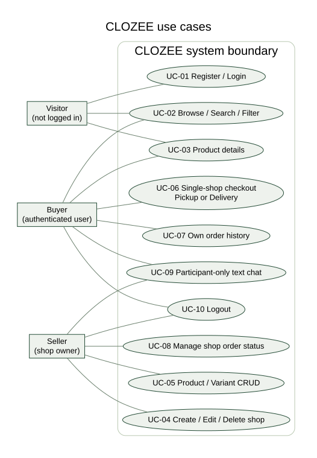

ตัวอย่างขั้นตอนการสั่งซื้อคือ ผู้ซื้อเข้าสู่ระบบ เลือกไซซ์และจำนวน เพิ่มลงตะกร้า แล้วเลือกนัดรับหรือจัดส่ง จากนั้นเซิร์ฟเวอร์จะตรวจราคา สต็อก และสิทธิ์อีกครั้ง ล็อกข้อมูล สร้างคำสั่งซื้อ และตัดสต็อกใน Transaction เดียวกัน หากสต็อกไม่พอหรือสินค้าปนหลายร้าน ระบบจะยกเลิกทั้งชุด

## 6. การออกแบบระบบ

### 6.1 ER Diagram และฐานข้อมูล

ฐานข้อมูลมี 11 ตาราง 89 คอลัมน์ 15 Foreign Keys และ 9 CHECK Constraints ใช้ InnoDB และ utf8mb4 ดังภาพที่ 2 และตารางที่ 4 ส่วนรายละเอียดทุกคอลัมน์อยู่ในภาคผนวก

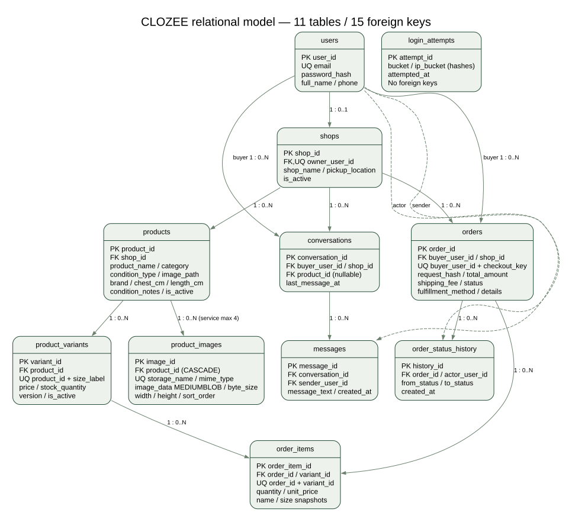

**ตารางที่ 4** ตารางในฐานข้อมูลและหน้าที่

| ตาราง | หน้าที่ |
| --- | --- |
| users | บัญชีผู้ใช้และรหัสผ่านแบบ Hash |
| shops | ร้านค้า ผูกกับเจ้าของแบบหนึ่งบัญชีต่อหนึ่งร้าน |
| products | ข้อมูลสินค้าและรายละเอียดเสื้อผ้า |
| product_variants | ไซซ์ ราคา และสต็อกของสินค้า |
| product_images | รูปสินค้าที่เก็บเป็น MEDIUMBLOB |
| orders | คำสั่งซื้อ วิธีรับสินค้า ยอดรวม และสถานะ |
| order_items | รายการสินค้าในคำสั่งซื้อ พร้อมชื่อ ไซซ์ และราคา ณ วันที่สั่ง |
| order_status_history | ประวัติการเปลี่ยนสถานะคำสั่งซื้อ |
| conversations | ห้องสนทนาระหว่างผู้ซื้อกับร้าน |
| messages | ข้อความในห้องสนทนา |
| login_attempts | บันทึกการเข้าสู่ระบบผิดเพื่อจำกัดการลองซ้ำ |

ความสัมพันธ์สำคัญคือ หนึ่งผู้ใช้มีร้านได้ไม่เกินหนึ่งร้าน หนึ่งร้านมีได้หลายสินค้าและหลายคำสั่งซื้อ หนึ่งสินค้ามีได้หลายไซซ์และหลายรูป และหนึ่งคำสั่งซื้อมีได้หลายรายการ ตาราง login_attempts ไม่ผูก Foreign Key กับผู้ใช้ เพราะอีเมลที่กรอกผิดอาจไม่ใช่บัญชีจริง

### 6.2 สถาปัตยกรรมระบบ

เบราว์เซอร์รับ HTML, CSS และ JavaScript จาก PHP ที่ทำงานหลัง Apache ทุกคำขอที่แก้ไขข้อมูลต้องผ่าน Session, CSRF Token และ Service ที่ตรวจความเป็นเจ้าของ ก่อนใช้ PDO ติดต่อกับ MySQL ดังภาพที่ 3

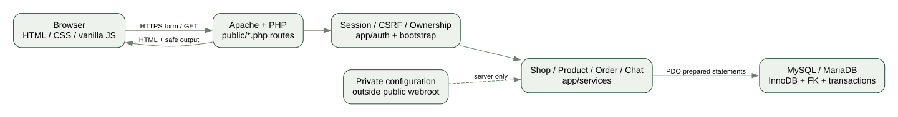

โค้ดแบ่งเป็นโฟลเดอร์ `public/` สำหรับหน้าเว็บที่เปิดได้จากภายนอก `app/` สำหรับ Service, การตรวจสิทธิ์ และ Template `database/` สำหรับ Schema และคำสั่ง SQL `scripts/` สำหรับเครื่องมือติดตั้ง และ `docs/` สำหรับรายงานและหลักฐาน ไฟล์ตั้งค่าที่มีรหัสผ่านอยู่นอกโฟลเดอร์สาธารณะ

**ตารางที่ 5** เทคโนโลยีที่ใช้

| ส่วน | เทคโนโลยี |
| --- | --- |
| ฝั่งเซิร์ฟเวอร์ | PHP และ PDO |
| ฐานข้อมูล | MySQL 8.0.46 บน Angsila |
| หน้าเว็บ | HTML, CSS และ JavaScript |
| เว็บเซิร์ฟเวอร์ | Apache บน Angsila |
| เครื่องมือจัดการ | phpMyAdmin และ FileZilla |
| การจัดการเวอร์ชัน | Git และ GitHub |
| การทดสอบ | สคริปต์ทดสอบ PHP, Playwright และ GitHub Actions |

## 7. การทำงานของระบบ

### 7.1 หน้าร้านและการค้นหา

ผู้ใช้เปิดดูและค้นหาสินค้าได้โดยไม่ต้องเข้าสู่ระบบ หน้าเว็บปรับตามขนาดหน้าจอทั้งคอมพิวเตอร์และมือถือ ดังภาพที่ 4 และภาพที่ 5 ภาพสินค้าในรายงานเป็นภาพสาธิต ไม่ใช่สินค้าหรือลูกค้าจริง

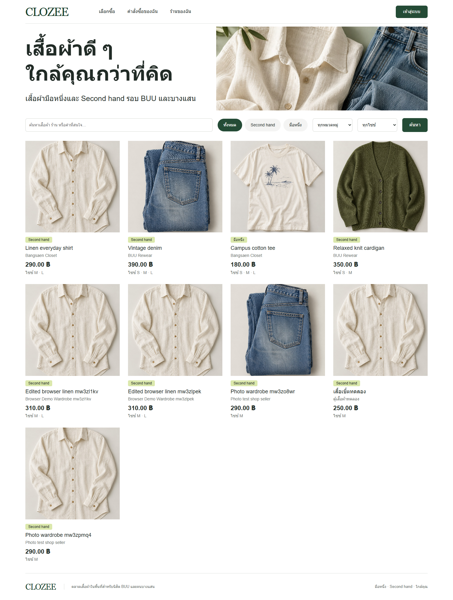

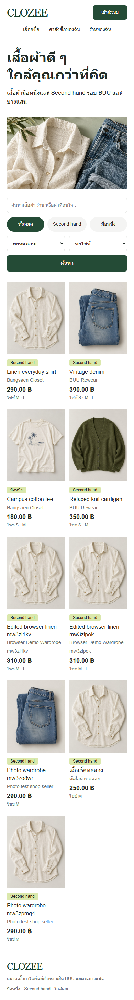

### 7.2 การเข้าสู่ระบบและการจัดการสินค้า

ผู้ขายต้องเข้าสู่ระบบก่อนจึงจะจัดการสินค้าได้ ดังภาพที่ 6 และเพิ่มสินค้าพร้อมหลายไซซ์ ราคา และสต็อกผ่านแบบฟอร์มในภาพที่ 7 เมื่อเพิ่มหรือแก้ไขสินค้าหรือร้านสำเร็จ ระบบจะแสดงแถบแจ้งเตือนสีเขียวเด่นบนหน้าจอพร้อมชื่อรายการ ระหว่างบันทึกปุ่มจะขึ้นว่า “กำลังบันทึก…” เพื่อกันการกดซ้ำ

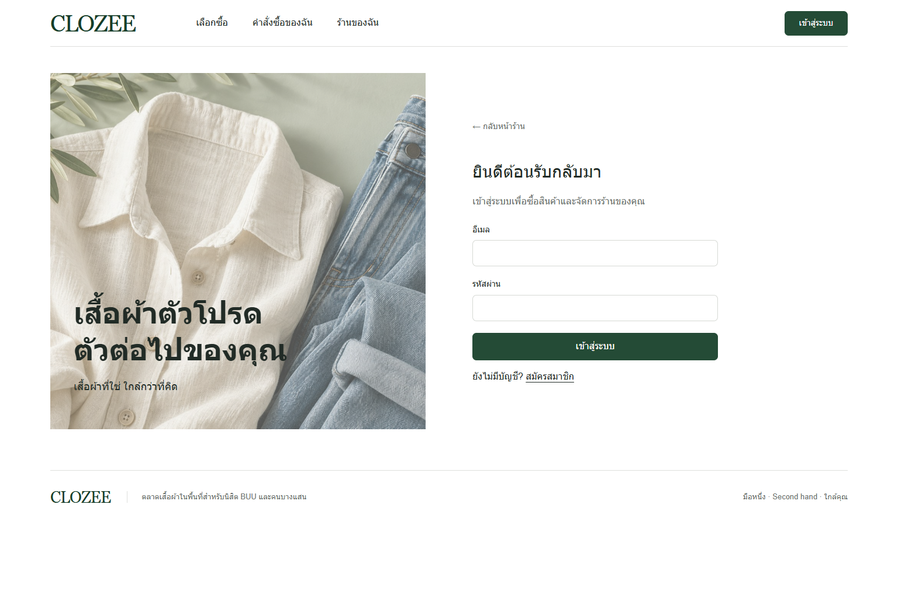

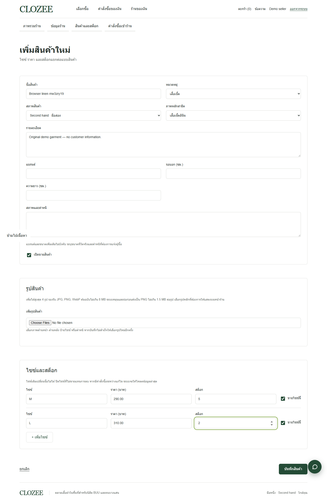

### 7.3 การสั่งซื้อและสถานะคำสั่งซื้อ

ผู้ซื้อเลือกนัดรับหรือจัดส่งแล้วกรอกรายละเอียด ดังภาพที่ 8 จากนั้นร้านเปลี่ยนสถานะตามลำดับที่ระบบอนุญาต ดังภาพที่ 9 และภาพที่ 10 ข้อมูลนัดรับในภาพเป็นข้อมูลสมมติ

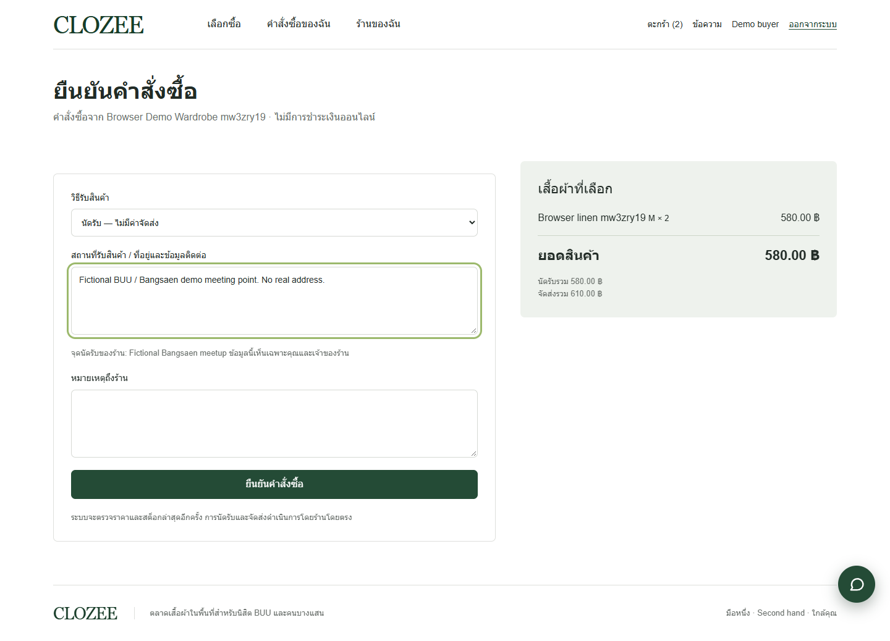

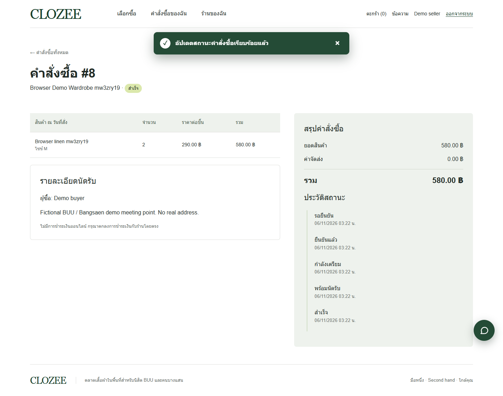

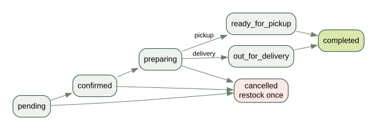

ร้านยกเลิกคำสั่งซื้อได้ก่อนถึงขั้นพร้อมรับหรือออกจัดส่ง และระบบจะคืนสต็อกเพียงครั้งเดียว คำสั่งซื้อที่เสร็จสิ้นหรือยกเลิกแล้วจะเปลี่ยนสถานะอีกไม่ได้

### 7.4 แชทระหว่างผู้ซื้อกับร้าน

ผู้ใช้ที่เข้าสู่ระบบจะเห็นไอคอนแชทที่มุมขวาล่างของทุกหน้า กดเพื่อเปิดหรือปิดได้ และผู้ซื้อเริ่มแชทจากหน้าสินค้าเพื่อถามไซซ์หรือสภาพสินค้าได้ ดังภาพที่ 11 รายการแชทแสดงคนที่ทักล่าสุดไว้บนสุด สลับเรียงแชทใหม่สุดหรือเก่าสุดได้ และมีตัวเลขแจ้งแชทที่ยังไม่อ่าน

หน้าเว็บตรวจข้อความใหม่จากเซิร์ฟเวอร์ทุก 3 วินาทีระหว่างเปิดห้องแชท จึงไม่ต้องรีเฟรชหน้า ข้อความเห็นได้เฉพาะคู่สนทนาและแสดงล่าสุด 100 ข้อความ

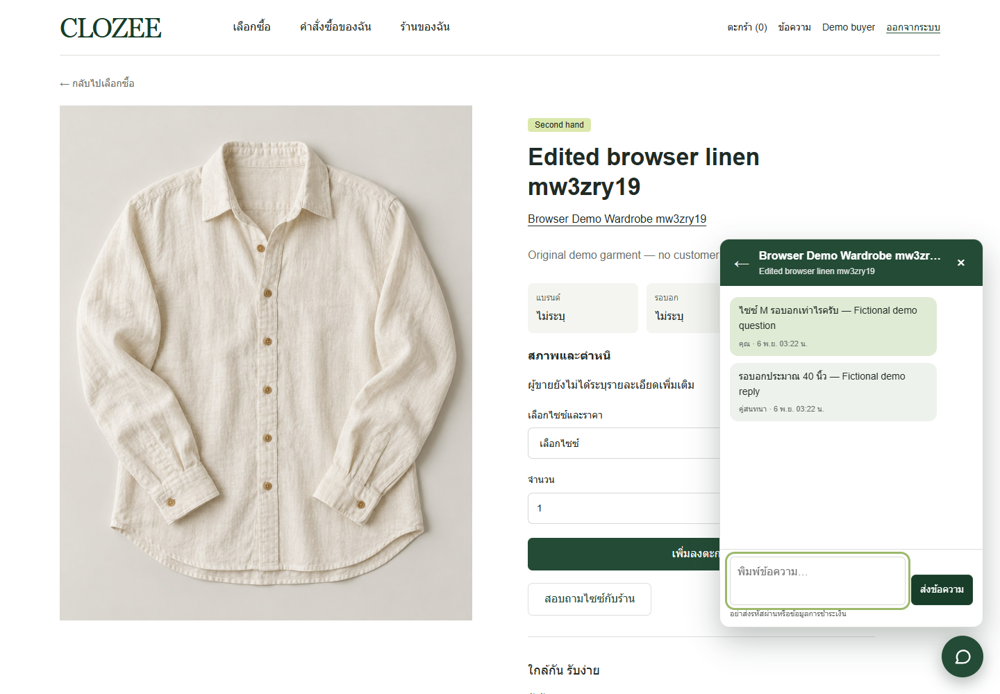

### 7.5 รูปสินค้าและรายละเอียดเสื้อผ้า

ผู้ขายอัปโหลดรูป JPG, PNG หรือ WebP ได้สูงสุด 4 รูป เลือกภาพหลักและลบภาพได้ และเพิ่มแบรนด์ รอบอก ความยาว และตำหนิได้ ดังภาพที่ 12 เบราว์เซอร์จะย่อรูปและแปลงเป็น PNG ไม่เกิน 1,600 พิกเซลและ 1.5 MiB จากนั้น PHP ตรวจไฟล์อีกครั้งก่อนบันทึกลงฐานข้อมูล

เนื่องจาก PHP บน Angsila ไม่มี GD และเขียนไฟล์ลงพื้นที่ส่วนตัวไม่ได้ ระบบจึงเก็บรูปในคอลัมน์ MEDIUMBLOB แทนการเก็บเป็นไฟล์

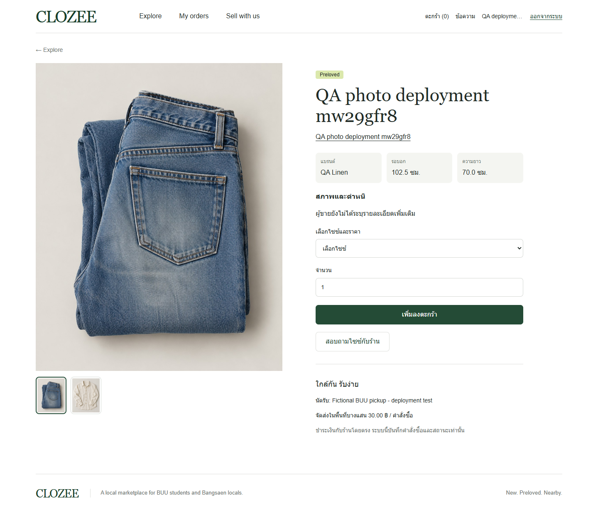

## 8. CRUD และการรักษาความถูกต้องของข้อมูล

### 8.1 CRUD ในระบบ

**ตารางที่ 6** การทำ CRUD ของสินค้า

| การทำงาน | SQL | การทำงานในระบบ |
| --- | --- | --- |
| Create | INSERT | เพิ่มสินค้าและไซซ์ใน Transaction เดียวกัน โดยใช้ร้านของผู้ที่เข้าสู่ระบบ |
| Read | SELECT | แสดงสินค้าในหน้าร้าน หน้ารายละเอียด และหน้าจัดการร้าน |
| Update | UPDATE | แก้ไขสินค้าและไซซ์ได้เฉพาะของร้านตนเอง โดยตรวจเลขรุ่นเพื่อกันการแก้สต็อกทับกัน |
| Delete | DELETE | ลบได้เฉพาะสินค้าที่ไม่มีประวัติการซื้อ ถ้ามีประวัติจะปฏิเสธและให้ปิดขายแทน |

ร้านค้าลบได้ที่หน้าข้อมูลร้าน โดยต้องพิมพ์ชื่อร้านให้ตรงเพื่อยืนยัน ระบบจะลบสินค้า รูป และแชทของร้านใน Transaction เดียวกัน แต่ถ้าร้านมีประวัติคำสั่งซื้อจะไม่ยอมให้ลบ เพื่อเก็บประวัติของผู้ซื้อ และให้ใช้การปิดร้านแทน

### 8.2 การสั่งซื้อใน Transaction

ฟังก์ชันสั่งซื้อล็อกข้อมูลตามลำดับ ผู้ซื้อ ร้าน สินค้า และไซซ์ ตรวจสต็อกอีกครั้ง แล้วจึงสร้างคำสั่งซื้อและตัดสต็อกพร้อมกัน เงินคำนวณเป็นจำนวนเต็มหน่วยสตางค์เพื่อเลี่ยงความคลาดเคลื่อนของทศนิยม ตัวอย่างโค้ดจาก `app/services/OrderService.php` มีดังนี้

```php
$v=query('SELECT * FROM {{product_variants}} WHERE variant_id=? FOR UPDATE',[$id])->fetch();
...
$changed=query('UPDATE {{product_variants}} SET stock_quantity=stock_quantity-?,version=version+1 WHERE variant_id=? AND stock_quantity>=?',[$qty,$id,$qty])->rowCount();
if($changed!==1) throw new ValidationException('สต็อกเปลี่ยนแล้ว กรุณาลองใหม่');
```

ระบบใช้รหัสกันคำขอซ้ำ หากผู้ซื้อกดส่งซ้ำด้วยข้อมูลเดิมจะได้คำสั่งซื้อเดิมและไม่ตัดสต็อกซ้ำ นอกจากนี้ ตาราง order_items ยังเก็บชื่อ ไซซ์ และราคา ณ วันที่สั่ง ประวัติการซื้อจึงไม่เปลี่ยนเมื่อร้านแก้ไขสินค้าภายหลัง

## 9. SQL JOIN

ไฟล์ `database/demo-joins.sql` เก็บตัวอย่างคำสั่ง และผลลัพธ์ด้านล่างมาจากฐานข้อมูลทดสอบที่มีเฉพาะข้อมูลสมมติ

### 9.1 INNER JOIN

คำสั่งนี้รวมคำสั่งซื้อกับผู้ซื้อ ร้าน และรายการสินค้า จึงแสดงเฉพาะแถวที่จับคู่ได้ครบ

```sql
SELECT o.order_id,u.full_name AS buyer,s.shop_name,oi.product_name_snapshot,
       oi.size_label_snapshot,oi.quantity,oi.unit_price,o.status
FROM orders o
INNER JOIN users u ON u.user_id=o.buyer_user_id
INNER JOIN shops s ON s.shop_id=o.shop_id
INNER JOIN order_items oi ON oi.order_id=o.order_id
ORDER BY o.order_id,oi.order_item_id;
```

**ตารางที่ 7** ตัวอย่างผล INNER JOIN (บางส่วน)

| คำสั่งซื้อ | ผู้ซื้อ | ร้าน | สินค้า | จำนวน | ราคาต่อหน่วย |
| --- | --- | --- | --- | --- | --- |
| 1 | Demo buyer | Browser Demo Wardrobe mvuqxv5p | Browser linen mvuqxv5p | 2 | 290.00 |
| 2 | Demo buyer | Browser Demo Wardrobe mvuqypuh | Browser linen mvuqypuh | 2 | 290.00 |
| 3 | Demo buyer | Browser Demo Wardrobe mvuqypuh | Browser linen mvuqypuh | 1 | 290.00 |

### 9.2 LEFT JOIN

คำสั่งนี้แสดงทุกร้าน รวมถึงร้านที่ยังไม่มีคำสั่งซื้อ และใช้ COUNT(o.order_id) เพราะ COUNT(\*) จะนับแถว NULL ของร้านที่ไม่มีคำสั่งซื้อเป็น 1

```sql
SELECT s.shop_id,s.shop_name,COUNT(o.order_id) AS order_count
FROM shops s LEFT JOIN orders o ON o.shop_id=s.shop_id
GROUP BY s.shop_id,s.shop_name ORDER BY s.shop_id;
```

**ตารางที่ 8** ตัวอย่างผล LEFT JOIN (บางส่วน)

| รหัสร้าน | ร้าน | จำนวนคำสั่งซื้อ |
| --- | --- | --- |
| 1 | Bangsaen Closet | 0 |
| 2 | BUU Rewear | 0 |
| 3 | The Next Wardrobe | 0 |
| 4 | Browser Demo Wardrobe mvuqxv5p | 1 |
| 5 | Browser Demo Wardrobe mvuqypuh | 2 |

เนื่องจากหนึ่งคำสั่งซื้อมีได้หลายรายการ การรวม total_amount หลัง JOIN กับ order_items จะทำให้ยอดซ้ำ ระบบจึงไม่รวมยอดจากผลลัพธ์แบบนั้น

## 10. การเข้าสู่ระบบและความปลอดภัย

### 10.1 การเข้าสู่ระบบและออกจากระบบ

ตอนสมัครสมาชิก ระบบเก็บรหัสผ่านด้วย password_hash และตอนเข้าสู่ระบบตรวจด้วย password_verify เมื่อสำเร็จจะเปลี่ยน Session ID ด้วย session_regenerate_id(true) เพื่อป้องกัน Session Fixation ตัวอย่างโค้ดจาก `app/auth/session.php` มีดังนี้

```php
$row=query('SELECT user_id,full_name,password_hash FROM {{users}} WHERE email=?',[$email])->fetch();
...
if (!password_verify($password,$row['password_hash']??$dummy)||!$row) {
```

การออกจากระบบใช้ POST พร้อม CSRF Token จากนั้นล้างข้อมูล Session ลบ Cookie และทำลาย Session และหากไม่มีการใช้งานเกิน 30 นาที Session จะถูกล้าง

### 10.2 มาตรการด้านความปลอดภัย

**ตารางที่ 9** ความเสี่ยงและวิธีป้องกัน

| ความเสี่ยง | วิธีป้องกัน |
| --- | --- |
| รหัสผ่านรั่ว | เก็บเฉพาะ Hash และไม่เก็บรหัสผ่านฐานข้อมูลใน GitHub |
| SQL Injection | ใช้ Prepared Statement ทุกคำสั่ง |
| XSS | Escape ข้อมูลด้วย htmlspecialchars และกำหนด Content Security Policy |
| CSRF | ทุกฟอร์มที่แก้ไขข้อมูลใช้ POST พร้อม Token |
| แก้ไขข้อมูลของผู้อื่น | ตรวจความเป็นเจ้าของจากผู้ใช้ใน Session |
| เดารหัสผ่าน | จำกัด 5 ครั้งต่อบัญชีและ IP และ 40 ครั้งต่อ IP ภายใน 15 นาที โดยเก็บเป็น Hash |
| ขโมย Session | Cookie ใช้ HttpOnly, SameSite=Lax และ Secure บน HTTPS |
| ไฟล์รูปปลอม | PHP ตรวจโครงสร้าง PNG ก่อนบันทึก และส่งรูปพร้อม nosniff |

## 11. การติดตั้งบน Angsila และการจัดการเวอร์ชัน

### 11.1 การติดตั้ง

การติดตั้งทำผ่าน VPN มหาวิทยาลัยด้วย phpMyAdmin และ FileZilla โดยตรวจปลายทางและแผน SQL ก่อนเขียนจริง ไฟล์หน้าเว็บอยู่ใน `public_html/clozee` ส่วนโค้ดภายในและไฟล์ตั้งค่าอยู่นอกเว็บ เนื่องจากฐานข้อมูลเดิมมีตาราง `users` ของงาน Lab อยู่แล้ว ตารางของ CLOZEE จึงใช้คำนำหน้า `clozee_` และตาราง Lab เดิมทั้งห้าตารางยังอยู่ครบ

ก่อนเพิ่มระบบรูปสินค้าเมื่อวันที่ 4 พฤศจิกายน 2569 ได้สำรอง 10 ตารางและไฟล์เดิม 52 ไฟล์ หลังติดตั้งตรวจแล้วว่าข้อมูลเดิมไม่เปลี่ยน และไฟล์รุ่นใหม่ตรงกันทั้ง 47 ไฟล์ ดังภาพที่ 13 และภาพที่ 14

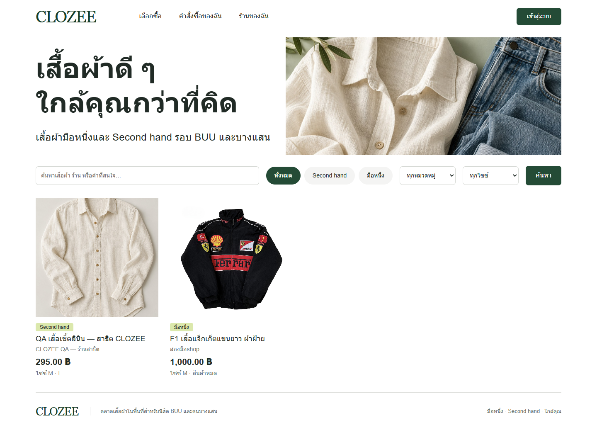

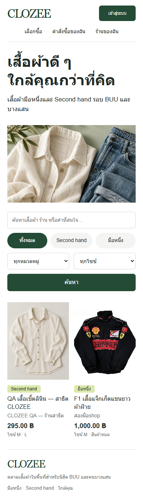

### 11.2 การจัดการเวอร์ชัน

ซอร์สโค้ด README และประวัติการแก้ไขอยู่บน GitHub ฟีเจอร์รูปสินค้าพัฒนาบน Branch แยกแล้วรวมผ่าน Pull Request และ GitHub Actions ทดสอบโค้ดกับ MySQL โดยอัตโนมัติ ไฟล์ตั้งค่าส่วนตัวและรหัสผ่านถูกยกเว้นด้วย `.gitignore`

## 12. ผลการทดสอบ

ผลด้านล่างแยกตามสภาพแวดล้อม เพราะการทดสอบในเครื่องไม่ได้ยืนยันผลบนเซิร์ฟเวอร์จริง

**ตารางที่ 10** สรุปผลการทดสอบ

| ชุดทดสอบ | สภาพแวดล้อม | ผล |
| --- | --- | --- |
| ระบบ ฐานข้อมูล และการทำงานพร้อมกัน | เครื่องพัฒนา PHP 8.4.27, MariaDB 11.4.9 | ผ่าน 62/62 ในแต่ละชุดชื่อตาราง |
| ตรวจไฟล์รูปภาพ | เครื่องพัฒนา ปิด GD/EXIF เหมือน Angsila | ผ่าน 23/23 |
| เบราว์เซอร์ ระบบหลัก แชท แจ้งเตือน และลบร้าน | เครื่องพัฒนา ปิด GD/EXIF | ผ่าน 26/26 |
| เบราว์เซอร์ รูปสินค้า | เครื่องพัฒนา ปิด GD/EXIF | ผ่าน 23/23 |
| อัปเกรดฐานข้อมูลจาก 10 ตาราง | เครื่องพัฒนา | ผ่าน 14/14 |
| รวมทุกชุดบน GitHub Actions รุ่นก่อนเพิ่มแชทลอย | PHP 8.3.36, MySQL 8.4.13 | ผ่าน 198/198 ต่อรูปแบบการรัน |
| ฟังก์ชันระบบหลักบนเว็บจริง รุ่นก่อนเพิ่มแชทลอย (30 ต.ค. 2569) | Angsila ผ่าน VPN | ผ่าน 30/30 |
| รูปสินค้าบนเว็บจริง รุ่นก่อนเพิ่มแชทลอย (4 พ.ย. 2569) | Angsila ผ่าน VPN | ผ่าน 13/13 |
| HTTP และความปลอดภัยบนเว็บจริง รุ่นก่อนเพิ่มแชทลอย (6 พ.ย. 2569) | Angsila ผ่าน VPN | ผ่าน 17/17 |

ผล GitHub Actions ดูได้ที่ [run 41119656814](https://github.com/Skyce38/CLOZEE/actions/runs/41119656814) ของ commit `fc45793` ซึ่งเป็นรุ่นที่ติดตั้ง และ [run 41857503966](https://github.com/Skyce38/CLOZEE/actions/runs/41857503966) ของ commit `13a5e73` ที่รวมเข้า main ส่วนรายละเอียดแต่ละข้ออยู่ใน `docs/test-results.md`

การทดสอบบนเว็บจริงใช้ข้อมูลสมมติทั้งหมด ครอบคลุมการสมัครสมาชิก การจัดการสินค้า นัดรับ จัดส่ง การยกเลิกพร้อมคืนสต็อก แชท และการปฏิเสธผู้ใช้ที่ไม่มีสิทธิ์ เมื่อทดสอบเสร็จได้ปิดร้านและสินค้าทดสอบของรอบรูปสินค้าแล้ว

การทดสอบการทำงานพร้อมกันใช้ PHP สองโปรเซสแย่งซื้อสินค้าชิ้นสุดท้าย ผลคือสำเร็จเพียงคำขอเดียวและสต็อกเหลือศูนย์ ส่วนการส่งคำขอซ้ำด้วยรหัสเดียวกันได้คำสั่งซื้อเดียวและตัดสต็อกครั้งเดียว

## 13. การวิเคราะห์ผลและข้อจำกัด

### 13.1 การวิเคราะห์ผล

- การล็อกแถวร่วมกับการตรวจสต็อกใน Transaction ป้องกันการขายเกินจำนวนได้ตามผลทดสอบ
- การเก็บข้อมูล ณ วันที่สั่งซื้อทำให้ประวัติไม่เปลี่ยน โดยหลังแก้ราคาจาก 290 เป็น 295 บาทบนเว็บจริง คำสั่งซื้อเดิมยังแสดงราคาเดิม
- ข้อจำกัดของเซิร์ฟเวอร์จริงมีผลต่อการออกแบบ เพราะ Angsila ไม่มี GD จึงต้องเปลี่ยนจากการเก็บรูปเป็นไฟล์มาเก็บในฐานข้อมูล ซึ่งแลกกับการที่ฐานข้อมูลและไฟล์สำรองใหญ่ขึ้น
- การทดสอบช่วยพบข้อบกพร่องจริง เช่น ค่าคีย์ในฟอร์มไซซ์ที่ถูกแก้อาจแทรก HTML ลงในหน้าแสดงข้อผิดพลาด จึงแก้ไขและเพิ่มชุดทดสอบไว้
- รอบทดสอบรูปสินค้าบนเว็บจริงต้องแก้สคริปต์ทดสอบสามจุดก่อนรันผ่านครบ โดยไม่ต้องแก้โค้ดของเว็บ

### 13.2 ข้อจำกัดของระบบ

- ปัญหาที่ตั้งไว้ยังเป็นสมมติฐาน เพราะยังไม่ได้สำรวจผู้ใช้จริง
- ยังไม่ได้ทดสอบการเข้าเว็บนอก VPN, Safari, Firefox, มือถือจริง, การกู้คืนข้อมูลสำรอง, penetration test และ load test
- การแย่งซื้อพร้อมกันและการลบสินค้าจริงทดสอบเฉพาะบนฐานข้อมูลแยก ไม่ได้ทำซ้ำบนเว็บจริง
- ยังไม่ทราบโควตาฐานข้อมูลบน Angsila ซึ่งรูปครบ 4 รูปอาจใช้พื้นที่ประมาณ 6 MiB ต่อสินค้า
- แชทตรวจข้อความใหม่เป็นรอบทุก 3 วินาที ไม่ได้เชื่อมต่อแบบ WebSocket และสถานะอ่านแล้วเก็บในเบราว์เซอร์ของผู้ใช้ จึงไม่ตรงกันข้ามเครื่อง
- รายการคำสั่งซื้อ แชท และร้านแสดงล่าสุดไม่เกิน 100 รายการ
- ระบบไม่มีสรุปยอดขาย การชำระเงินออนไลน์ การจัดส่งจริง การคืนเงิน และการเข้าสู่ระบบด้วยบัญชีมหาวิทยาลัย

## 14. สรุปผลและแนวทางพัฒนาต่อ

### 14.1 สรุปผล

**ตารางที่ 11** ผลเทียบกับวัตถุประสงค์

| วัตถุประสงค์ | ผลที่ได้ |
| --- | --- |
| ออกแบบฐานข้อมูลเชิงสัมพันธ์ | ทำได้ 11 ตาราง พร้อม Foreign Key, UNIQUE และ CHECK |
| เข้าสู่ระบบและตรวจสิทธิ์ | ทำได้ และทดสอบการปฏิเสธผู้ใช้ที่ไม่มีสิทธิ์แล้ว |
| CRUD กับ MySQL | ทำได้ ส่วนการลบจริงทดสอบบนฐานข้อมูลแยก |
| สั่งซื้อและติดตามสถานะ | ทำได้ ทั้งนัดรับและจัดส่ง |
| ติดตั้งบน Angsila | ทำได้ และทดสอบผ่าน VPN มหาวิทยาลัยแล้ว |

CLOZEE ทำงานได้ตามขอบเขตที่กำหนด และแสดงให้เห็นว่าการออกแบบฐานข้อมูลที่ดีช่วยรักษาความถูกต้องของสต็อกและประวัติการซื้อได้จริง

### 14.2 แนวทางพัฒนาต่อ

- **ระยะสั้น:** สำรวจความเห็นนิสิตเพื่อตรวจสอบปัญหาที่ตั้งไว้ ทดสอบบนมือถือจริงและเบราว์เซอร์อื่น และซ้อมกู้คืนข้อมูลสำรอง
- **ระยะกลาง:** เพิ่มสรุปยอดขายของร้าน การให้คะแนนร้าน และตัวเลือกเปลี่ยนภาษาของหน้าเว็บ
- **ระยะยาว:** เชื่อมระบบชำระเงินและบริการจัดส่ง และขยายพื้นที่ให้บริการโดยแสดงร้านตามตำแหน่งที่ใกล้ผู้ซื้อ

## 15. ลิงก์ของโครงงาน

**ตารางที่ 12** ลิงก์ที่ใช้ตรวจงาน

| รายการ | ลิงก์ |
| --- | --- |
| เว็บไซต์บน Angsila (ต้องเชื่อมต่อ VPN มหาวิทยาลัย) | https://angsila.informatics.buu.ac.th/~68160207/clozee/ |
| GitHub Repository | https://github.com/Skyce38/CLOZEE |

## อ้างอิง

- Database-authen.pdf. เอกสารประกอบการสอนวิชา 89022167 Database Management: CRUD, Authentication, Git และข้อกำหนด Project
- CRUD-and-VERSION-CONTROL.pdf. เอกสารประกอบการสอนวิชา 89022167 Database Management
- Data-base-join.pdf. เอกสารประกอบการสอนวิชา 89022167 Database Management
- The Nation. (2568, 10 กุมภาพันธ์). Inside Thailand's luxury second-hand fashion boom. https://www.nationthailand.com/sustaination/40046112
- MySQL. InnoDB Locking Reads. https://dev.mysql.com/doc/refman/8.0/en/innodb-locking-reads.html
- MySQL. JOIN Clause. https://dev.mysql.com/doc/refman/8.0/en/join.html
- PHP Manual. Prepared statements and stored procedures. https://www.php.net/manual/en/pdo.prepared-statements.php
- PHP Manual. password_hash. https://www.php.net/manual/en/function.password-hash.php
- PHP Manual. session_regenerate_id. https://www.php.net/manual/en/function.session-regenerate-id.php
- OWASP. Cross-Site Request Forgery Prevention Cheat Sheet. https://cheatsheetseries.owasp.org/cheatsheets/Cross-Site_Request_Forgery_Prevention_Cheat_Sheet.html
- W3C. Portable Network Graphics (PNG) Specification. https://www.w3.org/TR/png/

<div class="appendix">

## ภาคผนวก: พจนานุกรมข้อมูล (Data Dictionary)

ฐานเดิมอ้าง information_schema บน MariaDB 11.4.9 และปรับตาม migration 002 ที่ติดตั้งจริงบน Angsila วันที่ 4 พฤศจิกายน 2569 รวม 11 ตาราง 89 คอลัมน์ 15 Foreign Keys และ 9 CHECK ชนิดตัวเลขอาจแสดง display width ต่างกันระหว่าง MariaDB/MySQL เวลาในฐานข้อมูลเป็น UTC ส่วน UI แปลงเป็นเวลาประเทศไทย

### conversations

**ตารางที่ 13** พจนานุกรมข้อมูลตาราง conversations

| Column | Type | NULL? | Default | Key / rule | Meaning |
| --- | --- | --- | --- | --- | --- |
| conversation_id | bigint(20) unsigned | NO | NULL | PRI; auto_increment | รหัสการสนทนา |
| buyer_user_id | bigint(20) unsigned | NO | NULL | MUL; FK → users.user_id | บัญชีผู้ซื้อ |
| shop_id | bigint(20) unsigned | NO | NULL | MUL; FK → shops.shop_id | รหัสร้าน |
| product_id | bigint(20) unsigned | YES | NULL | MUL; FK → products.product_id | รหัสสินค้า |
| created_at | timestamp | NO | current_timestamp() | - | เวลาสร้าง (UTC) |
| last_message_at | timestamp | YES | NULL | - | เวลาข้อความล่าสุด ใช้เรียง thread |

### login_attempts

**ตารางที่ 14** พจนานุกรมข้อมูลตาราง login_attempts

| Column | Type | NULL? | Default | Key / rule | Meaning |
| --- | --- | --- | --- | --- | --- |
| attempt_id | bigint(20) unsigned | NO | NULL | PRI; auto_increment | รหัสบันทึกการล็อกอินผิด |
| bucket | char(64) | NO | NULL | MUL | SHA-256 ของ IP + normalized email |
| ip_bucket | char(64) | NO | NULL | MUL | SHA-256 ของ IP เพื่อจำกัดการลองรวม |
| attempted_at | timestamp | NO | current_timestamp() | - | เวลา login ผิด เก็บชั่วคราว |

### messages

**ตารางที่ 15** พจนานุกรมข้อมูลตาราง messages

| Column | Type | NULL? | Default | Key / rule | Meaning |
| --- | --- | --- | --- | --- | --- |
| message_id | bigint(20) unsigned | NO | NULL | PRI; auto_increment | รหัสข้อความ |
| conversation_id | bigint(20) unsigned | NO | NULL | MUL; FK → conversations.conversation_id | รหัสการสนทนา |
| sender_user_id | bigint(20) unsigned | NO | NULL | MUL; FK → users.user_id | ผู้ส่งจริงจาก session |
| message_text | text | NO | NULL | - | ข้อความล้วน 1–2000 ตัวอักษร Escape เมื่อแสดงผล |
| created_at | timestamp | NO | current_timestamp() | - | เวลาสร้าง (UTC) |

### orders

**ตารางที่ 16** พจนานุกรมข้อมูลตาราง orders

| Column | Type | NULL? | Default | Key / rule | Meaning |
| --- | --- | --- | --- | --- | --- |
| order_id | bigint(20) unsigned | NO | NULL | PRI; auto_increment | รหัสคำสั่งซื้อ |
| buyer_user_id | bigint(20) unsigned | NO | NULL | MUL; FK → users.user_id | บัญชีผู้ซื้อ |
| shop_id | bigint(20) unsigned | NO | NULL | MUL; FK → shops.shop_id | รหัสร้าน |
| fulfillment_method | enum('pickup','delivery') | NO | NULL | - | pickup หรือ delivery |
| fulfillment_details | text | NO | NULL | - | สถานที่และรายละเอียดส่วนตัวที่ผู้ซื้อให้ร้าน |
| shipping_fee | decimal(10,2) | NO | 0.00 | - | ค่าจัดส่ง ณ เวลาสั่งซื้อ |
| total_amount | decimal(10,2) | NO | NULL | - | ผลรวมสินค้าและค่าจัดส่งจาก server |
| status | enum('pending','confirmed','preparing','ready_for_pickup','out_for_delivery','completed','cancelled') | NO | 'pending' | - | สถานะปัจจุบันตาม state machine |
| buyer_note | text | YES | NULL | - | หมายเหตุถึงร้าน |
| checkout_key | char(64) | NO | NULL | - | รหัสกันคำขอซ้ำ ไม่ซ้ำร่วมกับ buyer_user_id |
| request_hash | char(64) | NO | NULL | - | SHA-256 ของคำขอเพื่อป้องกันใช้ key เดิมกับข้อมูลอื่น |
| created_at | timestamp | NO | current_timestamp() | - | เวลาสร้าง (UTC) |
| updated_at | timestamp | NO | current_timestamp() | -; on update current_timestamp() | เวลาแก้ไขล่าสุด (UTC) |

### order_items

**ตารางที่ 17** พจนานุกรมข้อมูลตาราง order_items

| Column | Type | NULL? | Default | Key / rule | Meaning |
| --- | --- | --- | --- | --- | --- |
| order_item_id | bigint(20) unsigned | NO | NULL | PRI; auto_increment | รหัสรายการซื้อ |
| order_id | bigint(20) unsigned | NO | NULL | MUL; FK → orders.order_id | รหัสคำสั่งซื้อ |
| variant_id | bigint(20) unsigned | NO | NULL | MUL; FK → product_variants.variant_id | รหัสตัวเลือกไซซ์ |
| product_name_snapshot | varchar(180) | NO | NULL | - | ชื่อสินค้า ณ วันที่สั่ง |
| size_label_snapshot | varchar(50) | NO | NULL | - | ไซซ์ ณ วันที่สั่ง |
| quantity | int(10) unsigned | NO | NULL | - | จำนวน 1–99 |
| unit_price | decimal(10,2) | NO | NULL | - | ราคาต่อหน่วย ณ วันที่สั่ง |

### order_status_history

**ตารางที่ 18** พจนานุกรมข้อมูลตาราง order_status_history

| Column | Type | NULL? | Default | Key / rule | Meaning |
| --- | --- | --- | --- | --- | --- |
| history_id | bigint(20) unsigned | NO | NULL | PRI; auto_increment | รหัสประวัติสถานะ |
| order_id | bigint(20) unsigned | NO | NULL | MUL; FK → orders.order_id | รหัสคำสั่งซื้อ |
| actor_user_id | bigint(20) unsigned | NO | NULL | MUL; FK → users.user_id | ผู้สร้างคำสั่งซื้อหรือผู้เปลี่ยนสถานะ |
| from_status | varchar(30) | YES | NULL | - | สถานะเดิม NULL สำหรับการสร้างครั้งแรก |
| to_status | varchar(30) | NO | NULL | - | สถานะใหม่ |
| created_at | timestamp | NO | current_timestamp() | - | เวลาสร้าง (UTC) |

### products

**ตารางที่ 19** พจนานุกรมข้อมูลตาราง products

| Column | Type | NULL? | Default | Key / rule | Meaning |
| --- | --- | --- | --- | --- | --- |
| product_id | bigint(20) unsigned | NO | NULL | PRI; auto_increment | รหัสสินค้า |
| shop_id | bigint(20) unsigned | NO | NULL | MUL; FK → shops.shop_id | รหัสร้าน |
| product_name | varchar(180) | NO | NULL | - | ชื่อสินค้าในปัจจุบัน |
| description | text | YES | NULL | - | รายละเอียดร้านหรือสินค้า |
| category | varchar(80) | YES | NULL | - | หมวดหมู่จากรายการค่าที่อนุญาตใน PHP |
| condition_type | enum('new','secondhand') | NO | NULL | MUL | new หรือ secondhand |
| image_path | varchar(255) | YES | NULL | - | ชื่อภาพสาธิตที่อนุญาตในระบบ |
| is_active | tinyint(1) | NO | 1 | - | 1 เปิดใช้งาน / 0 ปิดใช้งาน |
| created_at | timestamp | NO | current_timestamp() | - | เวลาสร้าง (UTC) |
| updated_at | timestamp | NO | current_timestamp() | -; on update current_timestamp() | เวลาแก้ไขล่าสุด (UTC) |
| brand | varchar(100) | YES | NULL | - | แบรนด์ (ไม่บังคับ) |
| chest_cm | decimal(4,1) | YES | NULL | CHECK > 0 และ <= 300 | รอบอก ซม. |
| length_cm | decimal(4,1) | YES | NULL | CHECK > 0 และ <= 300 | ความยาว ซม. |
| condition_notes | varchar(1000) | YES | NULL | - | สภาพและตำหนิ |

### product_images

**ตารางที่ 20** พจนานุกรมข้อมูลตาราง product_images

| Column | Type | NULL? | Default | Key / rule | Meaning |
| --- | --- | --- | --- | --- | --- |
| image_id | bigint unsigned | NO | NULL | PRI; auto_increment | รหัสรูป |
| product_id | bigint unsigned | NO | NULL | FK → products.product_id; ON DELETE CASCADE | สินค้าเจ้าของรูป |
| storage_name | varchar(64) | NO | NULL | UNIQUE | รหัสสุ่ม ไม่ใช่ path ไฟล์ |
| mime_type | varchar(32) | NO | NULL | server allowlist | MIME รูป; รูปใหม่เป็น image/png |
| byte_size | int unsigned | NO | NULL | CHECK 1..1572864 และเท่ากับ OCTET_LENGTH(image_data) | ขนาดไบต์จริง |
| image_data | mediumblob | NO | NULL | CHECK ขนาดร่วมกับ byte_size | ข้อมูลภาพ binary ที่ตรวจแล้ว |
| width | smallint unsigned | NO | NULL | CHECK 1..1600 | ความกว้างพิกเซล |
| height | smallint unsigned | NO | NULL | CHECK 1..1600 | ความสูงพิกเซล |
| sort_order | tinyint unsigned | NO | 0 | composite index product_id,sort_order,image_id | ลำดับภาพ; ลำดับแรกเป็นปก |
| created_at | timestamp | NO | CURRENT_TIMESTAMP | - | เวลาสร้าง UTC |

### product_variants

**ตารางที่ 21** พจนานุกรมข้อมูลตาราง product_variants

| Column | Type | NULL? | Default | Key / rule | Meaning |
| --- | --- | --- | --- | --- | --- |
| variant_id | bigint(20) unsigned | NO | NULL | PRI; auto_increment | รหัสตัวเลือกไซซ์ |
| product_id | bigint(20) unsigned | NO | NULL | MUL; FK → products.product_id | รหัสสินค้า |
| size_label | varchar(50) | NO | NULL | - | ไซซ์ ตัวพิมพ์ใหญ่และไม่ซ้ำต่อสินค้า |
| price | decimal(10,2) | NO | NULL | - | ราคาต่อหน่วย DECIMAL; PHP คำนวณเป็นสตางค์ |
| stock_quantity | int(10) unsigned | NO | 0 | - | จำนวนพร้อมขาย 0–999999 |
| version | int(10) unsigned | NO | 1 | - | เลขรุ่นสำหรับป้องกันการแก้สต็อกทับกัน |
| is_active | tinyint(1) | NO | 1 | - | 1 เปิดใช้งาน / 0 ปิดใช้งาน |
| created_at | timestamp | NO | current_timestamp() | - | เวลาสร้าง (UTC) |
| updated_at | timestamp | NO | current_timestamp() | -; on update current_timestamp() | เวลาแก้ไขล่าสุด (UTC) |

### shops

**ตารางที่ 22** พจนานุกรมข้อมูลตาราง shops

| Column | Type | NULL? | Default | Key / rule | Meaning |
| --- | --- | --- | --- | --- | --- |
| shop_id | bigint(20) unsigned | NO | NULL | PRI; auto_increment | รหัสร้าน |
| owner_user_id | bigint(20) unsigned | NO | NULL | UNI; FK → users.user_id | เจ้าของร้าน หนึ่งร้านต่อบัญชี |
| shop_name | varchar(150) | NO | NULL | - | ชื่อร้าน |
| description | text | YES | NULL | - | รายละเอียดร้านหรือสินค้า |
| pickup_location | varchar(255) | YES | NULL | - | จุดนัดรับที่ร้านระบุ |
| is_active | tinyint(1) | NO | 1 | - | 1 เปิดใช้งาน / 0 ปิดใช้งาน |
| created_at | timestamp | NO | current_timestamp() | - | เวลาสร้าง (UTC) |
| updated_at | timestamp | NO | current_timestamp() | -; on update current_timestamp() | เวลาแก้ไขล่าสุด (UTC) |

### users

**ตารางที่ 23** พจนานุกรมข้อมูลตาราง users

| Column | Type | NULL? | Default | Key / rule | Meaning |
| --- | --- | --- | --- | --- | --- |
| user_id | bigint(20) unsigned | NO | NULL | PRI; auto_increment | รหัสบัญชีผู้ใช้ |
| full_name | varchar(120) | NO | NULL | - | ชื่อแสดงผล |
| email | varchar(190) | NO | NULL | UNI | อีเมลไม่ซ้ำ ปรับเป็นตัวพิมพ์เล็กใน PHP |
| password_hash | varchar(255) | NO | NULL | - | รหัสผ่านที่ผ่าน password_hash เท่านั้น |
| phone | varchar(30) | YES | NULL | - | เบอร์โทร (optional; ปัจจุบันไม่ใช้ในฟอร์ม) |
| created_at | timestamp | NO | current_timestamp() | - | เวลาสร้าง (UTC) |
| updated_at | timestamp | NO | current_timestamp() | -; on update current_timestamp() | เวลาแก้ไขล่าสุด (UTC) |

### Unique constraints

**ตารางที่ 24** ข้อจำกัดความไม่ซ้ำของข้อมูล

| Table | Index | Columns |
| --- | --- | --- |
| conversations | PRIMARY | conversation_id |
| login_attempts | PRIMARY | attempt_id |
| messages | PRIMARY | message_id |
| orders | PRIMARY | order_id |
| orders | uq_order_checkout | buyer_user_id,checkout_key |
| order_items | PRIMARY | order_item_id |
| order_items | uq_order_variant | order_id,variant_id |
| order_status_history | PRIMARY | history_id |
| products | PRIMARY | product_id |
| product_images | PRIMARY | image_id |
| product_images | ux_product_images_storage | storage_name |
| product_variants | PRIMARY | variant_id |
| product_variants | uq_variants_product_size | product_id,size_label |
| shops | PRIMARY | shop_id |
| shops | uq_shops_owner | owner_user_id |
| users | PRIMARY | user_id |
| users | uq_users_email | email |

### กติกาที่ต้องตรวจใน PHP

ทุก order item ต้องอยู่ในร้านของ order, ผู้ส่งแชทต้องเป็นผู้ร่วมสนทนา, สินค้าต้องมีอย่างน้อยหนึ่ง variant, order ต้องมีอย่างน้อยหนึ่ง item, สต็อกต้องไม่ถูกขายเกิน, state transition ต้องตรงวิธีรับสินค้า และราคาต้องมาจาก server ดู implementation-decisions.md สำหรับ CHECK และ business rules ฉบับเต็ม

รูปสินค้าไม่เกิน 4 รูปต่อสินค้า บังคับใน service ภายใต้ row lock ของสินค้า; image endpoint ตรวจสถานะสินค้า/ร้านและสิทธิ์เจ้าของก่อนส่ง bytes ไม่ดึง BLOB ในรายการสินค้าทุกแถว

</div>
